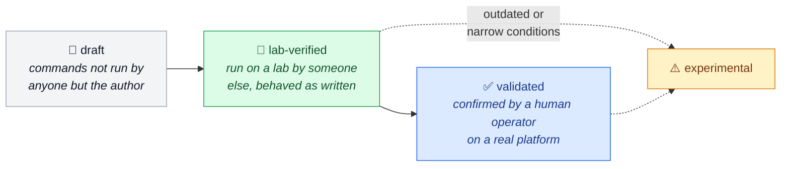

[← OzarLand home](https://github.com/OzarLand/ozarland)

# 🏗️ kolla-ansible-deployment-patterns

**Ways to deploy OpenStack with Kolla-Ansible, compared side by side.**

<!-- status-badges:start -->
  
  
  
  
<!-- status-badges:end -->
  
  

  <a href="#index"><b>Index</b></a> ·
  <a href="#-how-much-each-page-was-checked"><b>Status</b></a> ·
  <a href="#-first-pages-to-write"><b>Wanted</b></a> ·
  <a href="#-contributing"><b>Contribute</b></a>

---

Written so far from upstream documentation and lab builds; **operators' own patterns are what this repository is
waiting for.**

Part of [OzarLand](https://github.com/OzarLand/ozarland): *a shared land for better OpenStack operations.* No imposed
tools, no single way of operating OpenStack. The [🤖 openstack-operator-skills](https://github.com/OzarLand/openstack-operator-skills)
Claude skills draw on these pages and carry their status with them; a correction belongs here first.

> [!NOTE]
> **No architecture is presented as correct.** Every pattern states its context, its benefits, its limits and the
> lessons its operators learned. Two patterns can contradict each other and both be right in their context.

## 🎯 Scope

This repository documents the many ways operators deploy OpenStack with
[Kolla-Ansible](https://docs.openstack.org/kolla-ansible/latest/), so that someone planning or changing a
deployment can compare approaches and learn from others' experience.

| ✅ In scope | ❌ Out of scope |
|---|---|
| Reference topologies and node roles, from all-in-one labs to multi-controller, multi-network-node production | Running instances: see [openstack-vm-runbooks](https://github.com/OzarLand/openstack-vm-runbooks) |
| Lab, pre-production and production environments: how they differ and how they are kept comparable | Upgrade campaigns beyond release notes: planned for a future `openstack-upgrade-playbooks` repository; until it exists, release notes and upgrade reports live in `version-notes/` |
| Network design: interfaces, management/API/tunnel/external/storage networks, OVN versus OVS, provider networks, MTU, bonding | Other deployment tools: welcome as separate pattern repositories when their operators show up |
| Storage choices: Ceph, LVM, NFS and others for Glance, Cinder and Nova; what is shared and what is local | Copies of the upstream documentation. A page may synthesise the upstream documentation and source code, but it says so in *Validity and limits*, adds the operational context (what fails, what it costs, what to check), and stays `draft` until someone other than its author has run it |
| Inventories, `globals.yml`, group and host variables, configuration overrides: how they are organised and versioned across environments | |
| Secrets and configuration files: how `passwords.yml` and certificates are handled (never their content) | |
| Architectural choices and their operational consequences | |
| Errors met during deployment and reconfiguration, with their causes and fixes | |
| Differences between Kolla-Ansible and OpenStack releases that affect a pattern, and the precautions they require | |

## 🧭 What a pattern page covers

Pattern pages follow the shared [deployment pattern template](https://github.com/OzarLand/ozarland/blob/main/community/templates/deployment-pattern.md):

Deployment errors follow the
[runbook template](https://github.com/OzarLand/ozarland/blob/main/community/templates/runbook.md). Day-2 operations
are patterns too (`kind: pattern`), whose procedure steps carry the runbook-style ⚠️ and 🛑 warnings. Release notes
follow the [upgrade playbook template](https://github.com/OzarLand/ozarland/blob/main/community/templates/upgrade-playbook.md),
upgrade reports the [experience report template](https://github.com/OzarLand/ozarland/blob/main/community/templates/experience-report.md).
Each folder's README lists its pages and the template to use.

## 🗂️ How content is organised

| Folder | What it holds |
|---|---|
| 🏗️ `topologies/` | One pattern per topology, from all-in-one to large multinode |
| 🌐 `networking/` | Network designs and their trade-offs |
| 💾 `storage/` | Storage designs and their trade-offs |
| 🧾 `configuration/` | Inventory layouts, variable organisation, environment separation, secrets handling |
| 🧩 `services/` | One service or integration at a time: what to prepare, what to set, where it fails |
| 🧯 `deployment-errors/` | Errors met during deploy/reconfigure/upgrade-prepare, cause and fix |
| ⚙️ `operations/` | Day-2 procedures on a running deployment: adding and removing hosts, backups, recoveries |
| 📌 `version-notes/` | Per Kolla-Ansible / OpenStack release: what changed that affects deployments |
| ⚖️ `comparisons/` | Side-by-side comparisons of patterns on one dimension (e.g. OVN vs OVS, Ceph vs LVM) |
| 📄 `templates/` | Deployment-pattern template |

## 🔬 How much each page was checked

Every page carries a status in its front matter and in the index below
([knowledge lifecycle](https://github.com/OzarLand/ozarland/blob/main/docs/knowledge-lifecycle.md#page-statuses)):

<b>The four statuses, word for word</b>

| Status | What it means |
|---|---|
| `draft` | Written; its commands have not been run by anyone other than the author. |
| `lab-verified` | Its commands were run on a lab by someone other than the author, on the release stated in the page, and behaved as the page says. |
| `validated` | Confirmed by a human operator, other than the author, on a real platform. |
| `experimental` | Possibly outdated, or confirmed only under narrow conditions. |

<!-- status-progress:start -->
**Where things stand:** 39 pages, 8 `lab-verified`, 31 `draft`, none `validated` or `experimental`.

| Folder | Progress | Lab-verified or validated |
|---|---|---:|
| 🏗️ Topologies | ⬜⬜⬜⬜⬜⬜⬜⬜⬜⬜ | 0 / 2 |
| 🌐 Networking | ⬜⬜⬜⬜⬜⬜⬜⬜⬜⬜ | 0 / 2 |
| 💾 Storage | ⬜⬜⬜⬜⬜⬜⬜⬜⬜⬜ | 0 / 2 |
| 🧾 Configuration | 🟩🟩⬜⬜⬜⬜⬜⬜⬜⬜ | 1 / 6 |
| 🧩 Services | ⬜⬜⬜⬜⬜⬜⬜⬜⬜⬜ | 0 / 5 |
| 🧯 Deployment errors | 🟩🟩🟩🟩🟩🟩⬜⬜⬜⬜ | 5 / 9 |
| ⚙️ Operations | 🟩🟩🟩⬜⬜⬜⬜⬜⬜⬜ | 2 / 7 |
| 📌 Version notes | ⬜⬜⬜⬜⬜⬜⬜⬜⬜⬜ | 0 / 2 |
| ⚖️ Comparisons | ⬜⬜⬜⬜⬜⬜⬜⬜⬜⬜ | 0 / 4 |

🟩 lab-verified · ⬜ draft · one square is about 10 % of the folder's pages
<!-- status-progress:end -->
> [!WARNING]
> Nothing here has been confirmed on a production platform. Lab verification so far was done by OzarLand's AI lab
> agent on Kolla-Ansible 22.2.0 (OpenStack 2026.1) with Docker (Ubuntu 24.04 where the page records the OS), on
> small labs nested in an existing OpenStack cloud (all-in-one, or 3 controllers and 2 computes); each page's
> `confirmed_by` says what was run and what was not. No pattern here is presented as production-ready. Read a
> `draft` page as a well-sourced lead, and check every page's *Validity and limits* section before relying on it.

## Index

Click a category to open it.

<b>🏗️ Topologies</b>

| Pattern | Purpose | Scale | Network | Storage | Releases | Status |
|---|---|---|---|---|---|---|
| [Three controllers and two computes, nested inside an existing OpenStack cloud](topologies/three-controllers-two-computes-nested-in-an-openstack-cloud.md) | lab | 3 controllers, 2 computes | OVS, VXLAN | local instance store | 2026.1 | draft |
| [All-in-one lab on a single VM, nested inside an existing OpenStack cloud](topologies/all-in-one-lab-on-a-single-vm.md) | lab | 1 node (all-in-one) | OVS | local root disk | 2026.1 | draft |

<b>🌐 Networking</b>

| Networking pattern | Releases | Status |
|---|---|---|
| [Network interfaces, VLANs and MTU for a multinode deployment, with Open vSwitch and OVN side by side](networking/interfaces-vlans-and-mtu-ovs-and-ovn.md) | 2026.1 | draft |
| [Provider networks with Kolla-Ansible. Instances directly on a flat or VLAN network, without tunnels or routers](networking/provider-networks-instances-on-flat-or-vlan-networks.md) | 2026.1 | draft |

<b>🧯 Deployment errors</b>

| Deployment error | Releases | Status |
|---|---|---|
| [kolla-ansible deploy fails part-way because Ubuntu upgraded packages during the deploy](deployment-errors/unattended-upgrades-during-deploy-breaks-the-mariadb-cluster.md) | 2026.1 | lab-verified |
| [kolla-ansible deploy hangs on MariaDB port liveness: ProxySQL holds port 3306 on a node without HAProxy](deployment-errors/mariadb-exits-address-in-use-proxysql-on-a-node-without-haproxy.md) | 2026.1 | lab-verified |
| [kolla-ansible pull fails with "http: server gave HTTP response to HTTPS client": Docker does not know the registry is plain HTTP](deployment-errors/pull-fails-http-response-to-https-client-insecure-registry.md) | 2026.1 | lab-verified |
| [kolla-ansible deploy times out at "Wait for haproxy to listen on VIP": the internal VIP never comes up, or cannot be reached](deployment-errors/deploy-times-out-waiting-for-haproxy-on-the-internal-vip.md) | 2026.1 | draft |
| [kolla-ansible deploy fails with "The following Nova compute services failed to register themselves"](deployment-errors/nova-compute-services-failed-to-register.md) | 2026.1 | draft |
| [kolla-ansible prechecks fails with "Ansible version should be between ...", or plays fail on missing modules: the wrong Ansible or collections on the deploy host](deployment-errors/ansible-version-not-supported-or-wrong-ansible-on-the-deploy-host.md) | 2026.1 | draft |
| [RabbitMQ nodes do not form a cluster during kolla-ansible deploy: host name resolution, the Erlang cookie, closed ports or old cluster state](deployment-errors/rabbitmq-nodes-do-not-form-a-cluster.md) | 2026.1 | draft |
| [kolla-ansible deploy fails in the keystone role: Fernet bootstrap refused under --limit, key distribution over SSH failing, or keystone waiting for key 0](deployment-errors/keystone-fernet-bootstrap-or-key-distribution-fails.md) | 2026.1 | lab-verified |
| [kolla-ansible fails with "MariaDB cluster exists but is stopped": recovering a fully stopped Galera cluster with kolla-ansible mariadb-recovery](deployment-errors/mariadb-cluster-exists-but-is-stopped-run-mariadb-recovery.md) | 2026.1 | lab-verified |

<b>⚙️ Operations</b>

| Operations | Releases | Status |
|---|---|---|
| [Adding a compute node to a running Kolla-Ansible deployment](operations/adding-a-compute-node.md) | 2026.1 | draft |
| [deploy, reconfigure, upgrade and the others. Which kolla-ansible command to run after a change, and how to narrow it with --limit and --tags](operations/deploy-reconfigure-upgrade-and-limiting-runs.md) | 2026.1 | draft |
| [Removing or replacing a compute node in a Kolla-Ansible deployment](operations/removing-or-replacing-a-compute-node.md) | 2026.1 | draft |
| [Backing up and restoring the MariaDB cluster with kolla-ansible mariadb-backup](operations/mariadb-backup-and-restore-with-mariabackup.md) | 2026.1 | lab-verified |
| [Checking a Kolla-Ansible deployment after a change. kolla-ansible check, cluster state, service lists and one real instance](operations/checking-a-deployment-after-a-change.md) | 2026.1 | lab-verified |
| [Replacing a failed controller in a three-controller Kolla-Ansible deployment](operations/replacing-a-failed-controller.md) | 2026.1 | draft |
| [kolla-ansible bootstrap-servers. What it changes on the hosts, and the pitfalls of running it again on a live platform](operations/bootstrap-servers-what-it-changes-and-its-pitfalls.md) | 2026.1 | draft |

<b>💾 Storage</b>

| Storage pattern | Releases | Status |
|---|---|---|
| [Cinder and Glance back-ends compared. LVM, Ceph RBD and NFS, and what each choice implies](storage/cinder-and-glance-backends-compared-lvm-ceph-nfs.md) | 2026.1 | draft |
| [Where instance disks live. Local on each compute, in Ceph RBD, or boot from volume](storage/nova-instance-disks-local-ceph-rbd-or-boot-from-volume.md) | 2026.1 | draft |

<b>🧾 Configuration</b>

| Configuration pattern | Releases | Status |
|---|---|---|
| [Laying out the configuration. Inventory, globals.yml, per-service overrides and passwords.yml, kept in git without secrets](configuration/inventory-globals-overrides-and-secrets-layout.md) | 2026.1 | lab-verified |
| [Rotating the secrets in passwords.yml. Which ones a reconfigure applies, which need manual steps, and which need an outage](configuration/rotating-secrets-in-passwords-yml.md) | 2026.1 | draft |
| [CPU pinning, huge pages and NUMA on Kolla-Ansible computes. Host preparation, nova.conf overrides and the scheduler filter Kolla-Ansible does not enable](configuration/cpu-pinning-hugepages-and-numa-on-computes.md) | 2026.1 | draft |
| [TLS on the internal and external endpoints. What each switch encrypts, where the certificates go, and what changes on a running platform](configuration/tls-on-internal-and-external-endpoints.md) | 2026.1 | draft |
| [SR-IOV with Kolla-Ansible. VFs on the host, the Neutron SR-IOV agent, the PCI whitelist Kolla-Ansible writes, and the scheduler filter](configuration/sriov-neutron-ports-and-nova-pci-alias.md) | 2026.1 | draft |
| [A local registry and an offline deployment with Kolla-Ansible. What has to be mirrored, the variables that point at the mirrors, and the Docker setting that does not help](configuration/local-registry-and-offline-deployment.md) | 2026.1 | draft |

<b>🧩 Services and integrations</b>

| Service or integration | Releases | Status |
|---|---|---|
| [Octavia with the amphora provider. Certificates, the management network and the amphora image](services/octavia-amphora-certificates-and-management-network.md) | 2026.1 | draft |
| [External Ceph for Glance, Cinder, Cinder backup and Nova. Pools, users, the files Kolla-Ansible expects, and the libvirt secrets](services/external-ceph-for-glance-cinder-and-nova.md) | 2026.1 | draft |
| [Monitoring with Prometheus, Grafana and Alertmanager in Kolla-Ansible. What is deployed, and the rules, receivers and dashboards you still have to bring](services/monitoring-prometheus-grafana-and-alerting.md) | 2026.1 | draft |
| [Central logging with Fluentd and OpenSearch in Kolla-Ansible. Where logs go, how to search them by request ID, and how long they are kept](services/central-logging-fluentd-and-opensearch.md) | 2026.1 | draft |
| [Designate with the BIND9 back-end in Kolla-Ansible. Name servers, NS records, Neutron DNS integration, and how to check a record end to end](services/designate-dns-with-bind9-and-neutron.md) | 2026.1 | draft |

<b>⚖️ Comparisons</b>

| Comparison | Releases | Status |
|---|---|---|
| [ML2/OVS versus ML2/OVN with Kolla-Ansible. What changes in globals.yml, in operations and at upgrade time](comparisons/ml2-ovs-versus-ml2-ovn-with-kolla-ansible.md) | 2026.1 | draft |
| [Single control node versus three controllers. What high availability really costs in Kolla-Ansible](comparisons/single-control-node-versus-three-controllers.md) | 2026.1 | draft |
| [Separate network nodes versus network services on the controllers. What the network group decides in Kolla-Ansible](comparisons/separate-network-nodes-versus-network-services-on-controllers.md) | 2026.1 | draft |
| [Docker versus Podman as the container engine of a Kolla-Ansible deployment. What changes for operators, and what migrating costs](comparisons/docker-versus-podman-with-kolla-ansible.md) | 2026.1 | draft |

<b>📌 Version notes</b>

| Version notes | Releases | Status |
|---|---|---|
| [From 2025.1 to 2026.1. What changes for a Kolla-Ansible deployment, from the release notes](version-notes/2025.1-to-2026.1.md) | 2025.1, 2026.1 | draft |

<b>📓 Experience reports</b>

| Experience report | Releases | Status |
|---|---|---|
| [Upgrading an all-in-one lab from 2025.1 to 2026.1 with Kolla-Ansible, what happened](version-notes/upgrade-report-2025.1-to-2026.1-all-in-one-lab.md) | 2025.1, 2026.1 | draft |

## 📝 First pages to write

1. Three controllers, OVN, Ceph RBD, as run on a real platform, with its consequences.
2. Separated storage and storage-replication networks: why, and what it costs.
3. Keeping lab, pre-production and production inventories aligned, from a real multi-environment platform.
4. Any pattern you run in production: the context and the consequences matter more than the configuration.

## 🤝 Contributing

| | How |
|:-:|---|
| 💬 | **Ask a question or compare approaches:** [open a Q&A discussion](https://github.com/OzarLand/ozarland/discussions/new?category=q-a) in `ozarland`, where all OzarLand discussions live |
| 🏗️ | **Share your pattern:** copy `templates/deployment-pattern.md`, open a pull request. Describe your context first |
| ✅ | **Confirm a page, add a variant or a consequence to it:** open a pull request or a [*Documentation proposal* issue](https://github.com/OzarLand/kolla-ansible-deployment-patterns/issues/new?template=documentation-proposal.yml) |
| 🧯 | **Report a deployment error you solved:** open an issue with the [*Problem solved* form](https://github.com/OzarLand/kolla-ansible-deployment-patterns/issues/new?template=problem-solved.yml) |

> [!IMPORTANT]
> Rules that are not optional: no secrets (never `passwords.yml` content), no real hostnames, addresses or
> unredacted logs; say where your pattern runs and for how long. Full guide: [CONTRIBUTING.md](CONTRIBUTING.md).

## 🌍 Part of OzarLand

**OzarLand: a shared land for better OpenStack operations.** It started as a personal initiative by Soufian Zaouam
to share practical OpenStack operational knowledge, and it is meant to grow into a space where operators exchange
experience, document solutions and help each other run more reliable platforms. It is open to everyone: your
knowledge, questions and corrections are welcome.

| | Repository | What it holds |
|:-:|---|---|
| | [ozarland](https://github.com/OzarLand/ozarland) | Start here: newcomer path, community rules, [Discussions](https://github.com/OzarLand/ozarland/discussions) |
| 🔧 | [openstack-vm-runbooks](https://github.com/OzarLand/openstack-vm-runbooks) | Symptom-driven runbooks for instance problems |
| 🏗️ | `kolla-ansible-deployment-patterns` **(you are here)** | Ways to deploy with Kolla-Ansible, compared |
| 🧪 | [openstack-quick-lab](https://github.com/OzarLand/openstack-quick-lab) | A disposable OpenStack lab to practise on |
| 🤖 | [openstack-operator-skills](https://github.com/OzarLand/openstack-operator-skills) | Claude skills that apply this knowledge |

## ⚖️ License

All content, documentation and code alike, is licensed under the Apache License 2.0 ([LICENSE](LICENSE)). Reuse it
freely with attribution. See [licensing](https://github.com/OzarLand/ozarland/blob/main/docs/conventions/licensing.md).

OpenStack, Kolla and Kolla-Ansible are projects of the OpenInfra Foundation community. OzarLand is an independent
community initiative and is not affiliated with or endorsed by the OpenInfra Foundation.
