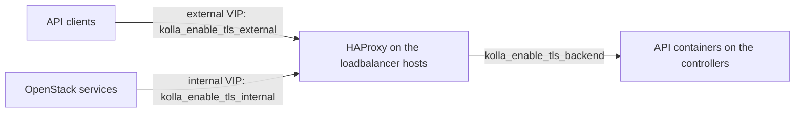

# TLS on the internal and external endpoints

## Context

Kolla-Ansible terminates TLS in HAProxy, on the VIPs. Three switches in `globals.yml` decide what is encrypted, and
each has its own certificate files, trust settings and consequences for clients. Operators often enable the external
one at first deployment and leave the internal one for later; enabling it later is possible, but it rewrites every
endpoint in the Keystone catalogue and the configuration of every service.

This page sorts the switches, shows where the files go, and says what an operator does to enable TLS on a platform
that is already running and to renew certificates. It follows the Kolla-Ansible 2026.1 TLS guide and the code of the
`loadbalancer` role.

## Topology



| Switch | Encrypts | Certificate (default path on the deploy host) |
|---|---|---|
| `kolla_enable_tls_external` | clients to HAProxy on the external VIP | `kolla_external_fqdn_cert`: `/etc/kolla/certificates/haproxy.pem` (certificate, chain and private key in one file) |
| `kolla_enable_tls_internal` | services and internal clients to HAProxy on the internal VIP | `kolla_internal_fqdn_cert`: `/etc/kolla/certificates/haproxy-internal.pem` |
| `kolla_enable_tls_backend` | HAProxy to the API containers, for Barbican, Cinder, Glance, Heat, Horizon, Ironic, Keystone, Neutron, Nova and Placement | per host and per service, see below; default `backend-cert.pem` and `backend-key.pem` |

## Network design

- **Separate VIPs.** If only one of internal or external TLS is enabled, the guide requires
  `kolla_internal_vip_address` and `kolla_external_vip_address` to differ.
- **A single VIP** (one network for everything): the guide says TLS can then be enabled only through the internal
  variables.
- **Names.** Endpoints use `kolla_internal_fqdn` and `kolla_external_fqdn`. They default to the VIP addresses, so
  without DNS names the certificates must carry the VIP addresses as IP subject alternative names. With names, the
  certificate must carry those names, and every host and client must resolve them.

## Storage design

Not affected.

## Inventory and configuration layout

```text
/etc/kolla/
  globals.yml                       # the switches and trust settings below
  certificates/                     # kolla_certificates_dir; never in git in clear text
    haproxy.pem                     # external: certificate + chain + key
    haproxy-internal.pem            # internal: certificate + chain + key
    ca/                             # CA certificates copied into the containers (kolla_copy_ca_into_containers)
      <your-ca>.crt
    proxysql-cert.pem, proxysql-key.pem   # database TLS through ProxySQL: needed as soon as internal TLS is on
                                          # and ProxySQL is enabled (the default), see below
    proxysql-ca.pem                 # optional: the intermediate that signed proxysql-cert.pem, if any
    backend-cert.pem, backend-key.pem               # backend TLS, used when nothing more specific exists
    <host>/<service>-cert.pem, <host>/<service>-key.pem   # most specific backend files win
```

```yaml
# globals.yml
kolla_enable_tls_external: "yes"
kolla_enable_tls_internal: "yes"
kolla_enable_tls_backend: "no"          # optional, see Key choices
kolla_external_fqdn: "<api.example.org>"
kolla_internal_fqdn: "<api-internal.example.org>"
kolla_copy_ca_into_containers: "yes"    # needed for a private CA or self-signed certificates
openstack_cacert: "/etc/ssl/certs/ca-certificates.crt"   # Ubuntu or Debian images; /etc/pki/tls/certs/ca-bundle.crt on Rocky
kolla_admin_openrc_cacert: "<path to the CA bundle on the hosts that use admin-openrc.sh>"
# kolla_haproxy_ssl_settings: "modern"  # default; "intermediate" for older clients
```

The backend certificate is looked up in this order: `<host>/<service>-cert.pem`, `<host>-cert.pem`,
`<service>-cert.pem`, then `kolla_tls_backend_cert`; the key in the same order. A certificate used for the backend must
be valid for the address HAProxy uses to reach each host.

**Internal TLS also turns on database TLS.** In 2026.1, `database_enable_tls_internal` follows
`kolla_enable_tls_internal` whenever `enable_proxysql` is true, and `enable_proxysql` defaults to `enable_mariadb`
(`ansible/group_vars/all/database.yml` and `proxysql.yml`). So on a default deployment, enabling internal TLS also:

- makes the `loadbalancer` role copy `proxysql-cert.pem` and `proxysql-key.pem` from `/etc/kolla/certificates/`, and
  `proxysql-ca.pem` if it exists (`tasks/copy-certs.yml`). The prechecks test only the HAProxy files, so a missing
  ProxySQL file passes `prechecks` and fails the `reconfigure` in the `loadbalancer` role;
- needs `proxysql-ca.pem` when the ProxySQL certificate is signed by an intermediate: a copy of that intermediate
  (release note of bug 2150449);
- appends `?ssl_ca=<openstack_cacert>` to every service's database connection: every service then connects to the
  database over TLS and must trust its CA, so with a private CA `openstack_cacert` and
  `kolla_copy_ca_into_containers` are required, not optional.

`kolla-ansible certificates` generates the ProxySQL files too, which is why a lab using it does not show the gap.
Backend TLS has the same link: `database_enable_tls_backend` follows `kolla_enable_tls_backend` with ProxySQL.

Handle the private keys like `passwords.yml`: encrypted in the configuration repository, or kept out of it (see
[laying out the configuration](inventory-globals-overrides-and-secrets-layout.md)).

## Key choices and their consequences

| Choice | Alternative(s) | Why this one here | Consequence in operation |
|---|---|---|---|
| Certificates from the organisation's CA or a public CA | `kolla-ansible certificates` (a generated test CA) | The guide says the generated CA is not suitable for production | Renewal is the operator's job, outside Kolla-Ansible; plan it |
| External TLS from day one | Add it later | Clients see HTTPS from the start; no endpoint change later | One certificate to renew per external name |
| Internal TLS too | Plain HTTP inside | Service passwords and tokens cross the internal network on every call | Every service must trust the CA (`kolla_copy_ca_into_containers`, `openstack_cacert`); more files to renew |
| Backend TLS | Stop at HAProxy | Encrypts the last hop, for networks where HAProxy and the API containers do not share a trusted segment | A certificate per host (and possibly per service); more to renew; `kolla_verify_tls_backend: false` exists but the guide does not recommend it |
| Let's Encrypt (`enable_letsencrypt`) | Certificates managed by hand | Renewal every 12 hours by a Kolla-Ansible container, deployed to HAProxy over SSH | Needs an ACME server reachable from the controllers; internal certificates need an internal ACME server (`letsencrypt_internal_cert_server`); HAProxy's socket then runs with admin access, which the guide notes |
| `kolla_externally_managed_cert: true` | Kolla-Ansible copies the files | Certificates are put on the hosts by another tool | Kolla-Ansible no longer copies them; the other tool must put them on every host, in the place Kolla-Ansible expects |

### Enabling TLS on a running platform

Before: read-only checks of the certificate files on the deploy host.

```bash
openssl x509 -in /etc/kolla/certificates/haproxy-internal.pem -noout -subject -enddate -ext subjectAltName
openssl verify -CAfile /etc/kolla/certificates/ca/<your-ca>.crt /etc/kolla/certificates/haproxy-internal.pem
# with an intermediate CA, pass it too: -untrusted <intermediate>.crt
openssl x509 -in /etc/kolla/certificates/proxysql-cert.pem -noout -subject -enddate   # internal TLS with ProxySQL
kolla-ansible prechecks -i <inventory>      # checks that the files named by kolla_*_fqdn_cert exist
```

> ⚠️ **State-changing.** With `kolla_enable_tls_internal` or `kolla_enable_tls_external` switched on, a
> `reconfigure` of the whole deployment rewrites HAProxy's configuration, the configuration of every service that
> calls another one, and the endpoints in the Keystone catalogue (`http://` becomes `https://`). With internal TLS
> and ProxySQL (the default), every service's database connection also moves to TLS. Every API container
> restarts; API calls fail or are refused during the run, and clients that do not trust the CA fail afterwards. The
> internal VIP serves only HTTPS as soon as the `loadbalancer` play has run, before the services are reconfigured.
> Endpoint URLs stored outside Kolla-Ansible (tenant Heat stacks, external tooling, monitoring) must be updated too.
> Running instances are not affected. Do it in a maintenance window, after a configuration backup and a MariaDB
> backup. Undo: set the switches back and run `reconfigure` again, which restores the `http://` endpoints the same way.

```bash
kolla-ansible reconfigure -i <inventory>
```

Do not limit this run with `--tags`: the endpoint URLs and the CA settings concern every service.

After: give clients the CA (`OS_CACERT`, or the system trust store), and regenerate `admin-openrc.sh` with
`kolla-ansible post-deploy -i <inventory>` so that it carries `OS_CACERT` from `kolla_admin_openrc_cacert`.

### Renewing a certificate

Replace the file under `/etc/kolla/certificates/` on the deploy host, check it with the same `openssl` commands, then
apply it to HAProxy:

> ⚠️ **State-changing.** Copies the new certificate to the load balancer hosts. Kolla-Ansible compares the
> configuration files of each running container with the new ones and restarts HAProxy where they differ; the VIP
> handling in the `loadbalancer` handlers restarts the backups first, then the host that holds the VIP, so API calls
> are interrupted for a few seconds. Undo: put the previous file back and run the same command.

```bash
kolla-ansible reconfigure -i <inventory> --tags loadbalancer
```

The ProxySQL certificate (`proxysql-cert.pem`, `proxysql-key.pem`, `proxysql-ca.pem`) is copied by the same
`loadbalancer` role, so the same command renews it, with the same short interruption of database connections.

A renewed backend certificate is copied by each service's role instead: run `reconfigure` with that service's tag
(`--tags keystone`, `--tags nova`, and so on), with the same short interruption for that service.

A new CA (not only a new certificate) is a larger change: the new CA must be trusted everywhere before a certificate
it signed is served. Put the new CA in `/etc/kolla/certificates/ca/` next to the old one, `reconfigure` everything,
then switch the certificate, then remove the old CA.

## What went wrong during deployment

Nothing observed for this page. Failures the code makes predictable:

- **Prechecks fail with `External haproxy certificate file is not found` or `Internal haproxy certificate file is not
  found`:** the file named by `kolla_external_fqdn_cert` or `kolla_internal_fqdn_cert` is missing on the deploy host.
- **The deploy times out at `Wait for haproxy to listen on VIP`:** HAProxy does not start, often because the `.pem`
  file has no private key or a key that does not match; read `docker logs haproxy`.
- **Services fail with `CERTIFICATE_VERIFY_FAILED` after internal TLS is enabled:** the CA is not trusted inside the
  containers. Check `kolla_copy_ca_into_containers` and `openstack_cacert`, and that the CA file is under
  `/etc/kolla/certificates/ca/`.

## Version notes

Written against Kolla-Ansible 2026.1. The variable names and default paths are those of the 2026.1 TLS guide and
`ansible/group_vars/all/`; `kolla_haproxy_ssl_settings` defaults to `modern` there, which refuses older TLS clients.

## Lessons learned

- Decide on internal TLS before the first deployment if you can: enabling it later is a full `reconfigure` with a
  visible API interruption.
- Put the certificate expiry dates where someone looks at them. Kolla-Ansible copies certificates; it does not
  watch them (except Let's Encrypt, which renews its own).
- Keep the VIP addresses in the certificates even when you use names: some internal clients may still be configured
  with addresses.

## Validity and limits

- Written from the Kolla-Ansible 2026.1 TLS and ACME guides and the code of `ansible/roles/loadbalancer`
  (`copy-certs.yml`, `precheck.yml`) and `ansible/module_utils/kolla_docker_worker.py` (the configuration comparison
  that restarts a container whose files changed). Not run on a lab for this page. Status `draft`.
- Database TLS is covered only as far as internal and backend TLS switch it on through ProxySQL (above); its
  certificate rotation was not detailed.
- Not covered: RabbitMQ TLS (`rabbitmq_enable_tls`), libvirt TLS, Octavia's
  own certificates (`kolla-ansible octavia-certificates`), and Podman.
- The CA rotation order above follows from how trust works; it was not run.

## Related

- [Rotating the secrets in passwords.yml](rotating-secrets-in-passwords-yml.md)
- [Laying out the configuration](inventory-globals-overrides-and-secrets-layout.md)
- Kolla-Ansible 2026.1: [TLS](https://docs.openstack.org/kolla-ansible/2026.1/admin/tls.html),
  [ACME](https://docs.openstack.org/kolla-ansible/2026.1/admin/acme.html),
  [HAProxy guide](https://docs.openstack.org/kolla-ansible/2026.1/reference/high-availability/haproxy-guide.html)

---

*Provenance: written by agent:ozarland-author, from the Kolla-Ansible 2026.1 documentation and code.
Reviewed in its pull request (see the page history). Checked by a human operator: not yet.*

**Worked for you, or not?** [Tell us in one line](https://github.com/OzarLand/kolla-ansible-deployment-patterns/issues/new?template=documentation-proposal.yml&page=configuration/tls-on-internal-and-external-endpoints.md&title=Feedback%3A+configuration/tls-on-internal-and-external-endpoints.md):
your release, your topology, and what happened.
