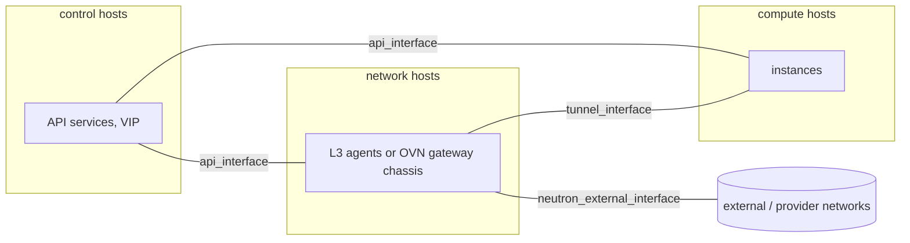

# Network interfaces, VLANs and MTU for a multinode deployment, with Open vSwitch and OVN side by side

## Context

The first `globals.yml` decision of a multinode deployment is which host interface carries which traffic. The
quickstart sets two (`network_interface` and `neutron_external_interface`); a production platform usually separates
more, on VLANs or bonds, and has to get the MTU right end to end. The choice between Open vSwitch (ML2/OVS, the
Kolla-Ansible default) and OVN changes where the external interface is needed and what MTU tenants get.

This page maps the Kolla-Ansible 2026.1 interface variables to the networks they carry, shows the two Neutron
back-ends side by side, and lists what to set for VLANs and MTU. It is written from the 2026.1 documentation,
`globals.yml`, the inventory and the role templates, not from one platform; it describes the mechanisms and their
consequences, not a recommended design.

## Topology

The groups that matter for networking in the 2026.1 multinode inventory:

| Group | Default members | Networking role |
|---|---|---|
| `control` | controllers | API services, databases, message queue; the internal VIP (`haproxy`, `keepalived`) |
| `network` | network hosts | ML2/OVS: L3, DHCP and metadata agents (`neutron` group). ML2/OVN: gateway chassis (`ovn-controller-network`) |
| `compute` | computes | Instances; tunnel endpoints; with ML2/OVN, `ovn-controller` (`ovn-controller-compute`) |
| `ovn-database` | `control` | OVN northbound and southbound databases and `ovn-northd` (ML2/OVN only) |



## Network design

### The interface variables

From `etc/kolla/globals.yml` and `ansible/group_vars/all/` in 2026.1. Every variable except
`neutron_external_interface` defaults, directly or indirectly, to `network_interface`, and "must contain an IP
address" (the `globals.yml` comment).

| Variable | Default | Carries |
|---|---|---|
| `network_interface` | `eth0` | Everything below that is not set separately |
| `api_interface` | `network_interface` | API services bind to it; the internal VIP; databases and message queue |
| `kolla_external_vip_interface` | `network_interface` | The external (public) VIP, when one is used |
| `tunnel_interface` | `network_interface` | VXLAN (ML2/OVS) or Geneve (ML2/OVN) tunnel endpoints |
| `migration_interface` | `api_interface` | Live migration traffic between computes |
| `dns_interface` | `network_interface` | Designate's DNS service |
| `octavia_network_interface` | `api_interface` | Octavia's management network |
| `neutron_external_interface` | `eth1` | The raw interface Neutron plugs into its external bridge (`br-ex`); no IP address |

`neutron_external_interface` is different from the others: the interface is plugged into an Open vSwitch bridge
(`neutron_bridge_name`, default `br-ex`), and the `globals.yml` comment recommends leaving it without an IP address.
Several interfaces are given as comma-separated lists, zipped with `neutron_bridge_name` and mapped to the physical
networks `physnet1` to `physnetN` (or `neutron_physical_networks`), as the Kolla-Ansible Neutron guide shows.

Per-host interface names belong in the inventory (`host_vars`, `group_vars`), not in `globals.yml`: the
`globals.yml` comment says so, and the [configuration layout pattern](../configuration/inventory-globals-overrides-and-secrets-layout.md)
explains why (extra variables override the inventory).

### Where the external interface is needed

| | ML2/OVS (`neutron_plugin_agent: "openvswitch"`, the default) | ML2/OVN (`neutron_plugin_agent: "ovn"`) |
|---|---|---|
| Routers and floating IPs | L3 agent namespaces on the `network` hosts | Logical routers; north-south traffic through the active gateway chassis |
| `neutron_external_interface` needed on | `network` hosts; also `compute` hosts with `enable_neutron_provider_networks` or DVR (Kolla-Ansible Neutron guide) | Gateway hosts (`ovn-controller-network`, which defaults to `network`); also computes with `neutron_ovn_distributed_fip`, which enables external bridges on them (Kolla-Ansible Neutron guide), or provider networks |
| Gateway selection | The L3 agent scheduler | `enable-chassis-as-gw` is set on hosts of `ovn-controller-network` (`ovn-controller` role, `setup-ovs.yml`) |
| Distributed floating IPs | DVR, a separate mode | `neutron_ovn_distributed_fip`, off by default in Kolla-Ansible |
| Tunnels | VXLAN, VNI range `1:1000` | Geneve, VNI range `1001:2000` (both from `ml2_conf.ini.j2`) |

### VLANs

Kolla-Ansible does not create VLAN or bond interfaces: the host's own network configuration does (netplan,
NetworkManager, systemd-networkd), and the interface variables name the result, for example `bond0.110` for
`api_interface`. The `globals.yml` comment suggests a bond with the same name on every host to avoid per-host names.

For VLAN **provider** networks on `neutron_external_interface`, note the 2026.1 `ml2_conf.ini.j2`: `network_vlan_ranges`
is empty unless Ironic is enabled, while `flat_networks` lists the physical networks. Neutron's VLAN type driver only
accepts the physical networks listed in `network_vlan_ranges`, so VLAN provider networks need an override:

```ini
# /etc/kolla/config/neutron/ml2_conf.ini
[ml2_type_vlan]
network_vlan_ranges = physnet1            # provider VLANs only; physnet1:<first>:<last> also lets tenants get VLANs
```

## Storage design

Not covered here. A separate storage network is set through the storage back-end's own configuration; see the
storage patterns.

## Inventory and configuration layout

```text
inventory/
  hosts                         # control, network, compute groups
  group_vars/
    control.yml                 # api_interface: bond0.110
    network.yml                 # neutron_external_interface: bond1
    compute.yml                 # tunnel_interface: bond0.120
globals.yml                     # neutron_plugin_agent, VIP addresses: one value for all hosts
config/neutron.conf             # [DEFAULT] global_physnet_mtu, when not 1500
config/neutron/ml2_conf.ini     # [ml2] path_mtu, [ml2_type_vlan] network_vlan_ranges
```

### MTU

Neutron computes the MTU of each network from the physical network MTU it is told about; by default it assumes
1500 bytes (Neutron's MTU guide). In the 2026.1 Neutron source, a tunnel network gets the smaller of
`global_physnet_mtu` and `path_mtu`, minus the IP header (20 bytes for IPv4 tunnel endpoints), minus the
encapsulation overhead:

| Underlying MTU | VXLAN (ML2/OVS): overhead 30 | Geneve (ML2/OVN): `max_header_size` 38, as Kolla-Ansible sets it |
|---|---|---|
| 1500 | 1450 | 1442 |
| 9000 | 8950 | 8942 |

Kolla-Ansible's 2026.1 templates do not set `global_physnet_mtu` or `path_mtu`. With jumbo frames on the
underlying network, set both through overrides, as Neutron's MTU guide describes ("Case 1"):

```ini
# /etc/kolla/config/neutron.conf
[DEFAULT]
global_physnet_mtu = 9000
```

```ini
# /etc/kolla/config/neutron/ml2_conf.ini
[ml2]
path_mtu = 9000
```

Existing networks keep their MTU: Neutron's guide says to update the `mtu` attribute of the networks that need the
new value. The physical switches, the host interfaces, bonds and VLAN sub-interfaces must all carry the larger MTU
first; Neutron only uses the value it is given.

A read-only check of what a host and a network actually have:

```bash
ip -d link show <interface>                                   # on the host: mtu, and the VLAN ID for a sub-interface
openstack network show <network-id> -c mtu -c provider:network_type
```

## Key choices and their consequences

| Choice | Alternative(s) | Why one would choose it | Consequence in operation |
|---|---|---|---|
| Separate `api_interface`, `tunnel_interface` and `neutron_external_interface` | Everything on `network_interface` | Tenant traffic does not compete with API, database and message queue traffic | More VLANs or NICs to configure on every host; more places for an MTU mismatch |
| ML2/OVS | ML2/OVN | Kolla-Ansible's default; agents and namespaces many operators already know | DHCP, L3 and metadata agents to keep alive on the network hosts; tenant MTU 1450 on a 1500 network |
| ML2/OVN | ML2/OVS | No L3 or DHCP agents; gateway chassis with BFD-based failover (Neutron OVN routing guide) | OVN databases on the control hosts to operate and back up; tenant MTU 1442 on a 1500 network |
| Jumbo frames underneath | 1500 everywhere | Tenants keep a 1500-byte MTU despite encapsulation | Every switch, bond and VLAN sub-interface must carry it; a single 1500-byte hop breaks large packets silently |
| Bond names identical on every host | Per-host interface names in `host_vars` | One value in `group_vars` for a whole group | The bond and VLAN layout must be the same everywhere |

## What went wrong during deployment

Nothing recorded yet: this page is written from the upstream documentation and source. A related lab failure is in
the runbooks: a tunnel MTU mismatch that drops large packets.

## Version notes

- 2026.1: the variables, defaults and templates above were read in Kolla-Ansible's `stable/2026.1` branch.
- Between 2025.1 and 2026.1, Kolla-Ansible removed the Linux Bridge mechanism driver, already removed from Neutron
  (release note `remove-neutron-linuxbridge`, present from the 2025.2 branch): ML2/OVS and ML2/OVN remain.
- Neutron agent wrappers are enabled by default from 2025.2 (release note `neutron-agent-wrappers-by-default`).

## Lessons learned

No first-hand lessons yet. What the sources stress:

- `neutron_external_interface` is the only interface without an IP address; plugging an interface that carries the
  host's management address into `br-ex` cuts the host off (the Neutron guide's "shared interface" section says a
  workaround is out of its scope).
- MTU is the most common silent failure of overlay networks: check it on every hop before deploying.

## Validity and limits

Written from Kolla-Ansible 2026.1 (`globals.yml`, `ansible/group_vars/all/`, the multinode inventory, the
`ml2_conf.ini.j2` template, the `ovn-controller` role, the Neutron guide) and Neutron 2026.1 (MTU guide, OVN routing
guide, and the MTU computation in `type_tunnel.py`, `type_vxlan.py` and `type_geneve.py`). Not applied on a platform.

Not covered: IPv6 tunnel endpoints (20 more bytes of overhead), DVR, OVS-DPDK, SR-IOV, Octavia's management network
in detail, BGP, and Kayobe's network configuration.

## Related

- [Laying out the configuration](../configuration/inventory-globals-overrides-and-secrets-layout.md)
- [Three controllers and two computes, nested inside an existing OpenStack cloud](../topologies/three-controllers-two-computes-nested-in-an-openstack-cloud.md):
  a lab where the hosting cloud forced a lower MTU
- [Tunnel MTU mismatch, large packets dropped](https://github.com/OzarLand/openstack-vm-runbooks/blob/main/networking/tunnel-mtu-mismatch-large-packets-dropped.md)
- Kolla-Ansible 2026.1: [Neutron guide](https://docs.openstack.org/kolla-ansible/2026.1/reference/networking/neutron.html),
  [multinode](https://docs.openstack.org/kolla-ansible/2026.1/user/multinode.html)
- Neutron 2026.1: [MTU considerations](https://docs.openstack.org/neutron/2026.1/admin/config-mtu.html),
  [OVN routing](https://docs.openstack.org/neutron/2026.1/admin/ovn/routing.html)
