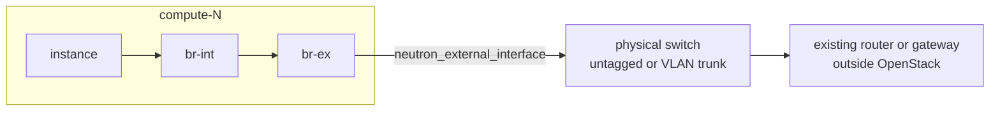

# Provider networks with Kolla-Ansible. Instances directly on a flat or VLAN network, without tunnels or routers

## Context

A self-service network lives in a tunnel (VXLAN or Geneve) and reaches the outside through a Neutron router and
floating IPs. A **provider network** maps a Neutron network onto a physical network, untagged (`flat`) or on a VLAN:
instances get addresses on that physical network and talk to it directly, with no tunnel, no Neutron router and no
NAT. Neutron's guide gives the usual reasons: performance-critical applications, and networks that must stay in an
existing addressing plan. Only administrators create them.

Kolla-Ansible deploys the bridges and mappings for them, but leaves three things to the operator: plugging the
computes into the physical network, allowing VLAN provider networks, and creating the networks. This page puts the
pieces together; the [interfaces, VLANs and MTU pattern](interfaces-vlans-and-mtu-ovs-and-ovn.md) covers the host
interfaces themselves.

## Topology



With self-service networks, only the `network` hosts (or OVN gateway chassis) need the external interface. With
provider networks, **every compute that hosts such instances** needs it: the traffic leaves the compute directly.

## Network design

- **Computes get an external bridge.** `enable_neutron_provider_networks: true` makes Kolla-Ansible create the external
  bridge on the `compute` hosts too (`computes_need_external_bridge` in `group_vars/all/neutron.yml`, which DVR and
  OVN distributed floating IPs also set). `neutron_external_interface` must then name an interface that exists on the
  computes, carries no IP address, and is cabled to the provider network or to a VLAN trunk.
- **Physical network names.** Each external interface is plugged into a bridge (`neutron_bridge_name`, `br-ex` by
  default) and mapped to a physical network, `physnet1` to `physnetN` by default, or the names in
  `neutron_physical_networks`. ML2/OVS writes them as `bridge_mappings` in `openvswitch_agent.ini`. Hosts may have
  different lists, in `host_vars` or `group_vars`, when not every host reaches every physical network (the
  Kolla-Ansible Neutron guide's example: controllers on two physical networks, computes on one).
- **Flat and VLAN.** In 2026.1, `ml2_conf.ini.j2` sets `flat_networks` to the physical networks, so flat provider
  networks work as deployed. `network_vlan_ranges` is empty unless Ironic is enabled, so VLAN provider networks need
  the override described in the interfaces pattern (`[ml2_type_vlan] network_vlan_ranges = physnet1`).
- **Gateway outside OpenStack.** The subnet's gateway is the physical network's router, not a Neutron router.
  Security groups still apply on each port.
- **MTU.** No encapsulation: the instances can use the physical network's MTU, as long as Neutron is told it
  (`global_physnet_mtu`, or `physical_network_mtus` per physical network; see the interfaces pattern).

## Storage design

Not affected.

## Inventory and configuration layout

```yaml
# globals.yml
enable_neutron_provider_networks: true
neutron_external_interface: "eth1"             # on every network and compute host
# several physical networks:
# neutron_external_interface: "eth1,eth2"
# neutron_bridge_name: "br-ex1,br-ex2"
# neutron_physical_networks: "physnet1,physnet2"
```

```ini
# /etc/kolla/config/neutron/ml2_conf.ini, for VLAN provider networks
[ml2_type_vlan]
network_vlan_ranges = physnet1
```

Then the networks, created by an administrator, as in Neutron's provider network guide:

> ⚠️ **State-changing.** Creates a shared network and subnet on the physical network. Instances of every project can
> then attach to it and get addresses from the allocation pool: choose a pool that no other system on that network
> uses. Undo: delete the subnet and the network once no port uses them.

```bash
openstack network create --share --provider-physical-network physnet1 \
  --provider-network-type vlan --provider-segment <vlan-id> provider-<vlan-id>
openstack subnet create --network provider-<vlan-id> --subnet-range <cidr> \
  --gateway <physical-gateway> --allocation-pool start=<first>,end=<last> \
  --dns-nameserver <resolver> provider-<vlan-id>-v4
```

For a flat network, `--provider-network-type flat` without `--provider-segment`.

## Key choices and their consequences

| Choice | Alternative(s) | Why one would choose it | Consequence in operation |
|---|---|---|---|
| Provider networks | Self-service networks with routers and floating IPs | No tunnel overhead, no NAT, addresses in an existing plan; the path does not go through a `network` host | Every compute needs the physical network and its VLANs; addressing is shared with the physical network and must not overlap; projects cannot create their own networks on it; instances on it are reached on their own address, without floating IPs |
| Flat network | VLAN networks | One untagged network per physical network, no VLAN range to configure | One network per interface and bridge; adding a network means adding an interface |
| VLAN networks | Flat | Many networks on one trunk | The `network_vlan_ranges` override, and every VLAN allowed on the switch ports of every compute |
| Shared provider network | One per project (`--project`, RBAC) | One network for every project | Every project's instances on one layer 2 segment; security groups are the only separation |

What the instances still need from Neutron on a provider network:

- **DHCP:** with ML2/OVS, from the DHCP agents on the `network` hosts, reached over the provider network; with OVN,
  answered by `ovn-controller` on each host.
- **Metadata:** there is no Neutron router to proxy it. Kolla-Ansible's `dhcp_agent.ini` sets
  `enable_isolated_metadata = true` and `force_metadata = true`, so with ML2/OVS the DHCP namespace serves it; with
  OVN, the metadata agent on each host does.
- **DNS servers:** the subnet's `--dns-nameserver`, or else Kolla-Ansible's `neutron_dnsmasq_dns_servers`, which
  defaults to well-known public resolvers, not reachable on an isolated network.

## What went wrong during deployment

Nothing recorded yet: no provider network has been built on the OzarLand labs. The interfaces pattern records the
`network_vlan_ranges` gap from the source, not from a failure.

## Version notes

- 2026.1: `flat_networks`, `network_vlan_ranges` and `bridge_mappings` read in `ml2_conf.ini.j2` and
  `openvswitch_agent.ini.j2`; `computes_need_external_bridge` and `neutron_dnsmasq_dns_servers` in
  `group_vars/all/neutron.yml`; `enable_isolated_metadata` and `force_metadata` in `dhcp_agent.ini.j2`.

## Lessons learned

No first-hand lessons yet. What the sources stress:

- The external interface on the computes must carry no IP address: Kolla-Ansible plugs it into an Open vSwitch
  bridge, and the Neutron guide calls a shared interface out of scope.
- Check the switch side first: the VLANs of every provider network must reach every compute that may host its
  instances, or an instance that lands on a compute without that VLAN boots without network.

## Validity and limits

Written from Kolla-Ansible 2026.1 (Neutron guide, `group_vars/all/neutron.yml`, `ml2_conf.ini.j2`,
`openvswitch_agent.ini.j2`, `dhcp_agent.ini.j2`) and Neutron 2026.1 (Open vSwitch provider network deployment guide,
networking introduction). Not deployed on a lab.

Not covered: routed provider networks (segments), SR-IOV, Ironic provisioning networks, IPv6 provider subnets, OVN's
own provider network settings in detail, and RBAC to share a provider network with some projects only.

## Related

- [Network interfaces, VLANs and MTU, with Open vSwitch and OVN side by side](interfaces-vlans-and-mtu-ovs-and-ovn.md)
- [ML2/OVS versus ML2/OVN](../comparisons/ml2-ovs-versus-ml2-ovn-with-kolla-ansible.md)
- Runbooks: [instance unreachable from outside](https://github.com/OzarLand/openstack-vm-runbooks/blob/main/networking/instance-unreachable-from-outside.md),
  [new instance gets no IP](https://github.com/OzarLand/openstack-vm-runbooks/blob/main/networking/new-instance-gets-no-ip-dhcp-agents-down.md),
  [new instance boots without metadata](https://github.com/OzarLand/openstack-vm-runbooks/blob/main/networking/new-instance-boots-without-metadata.md)
- Kolla-Ansible 2026.1: [Neutron guide](https://docs.openstack.org/kolla-ansible/2026.1/reference/networking/neutron.html)
- Neutron 2026.1: [Open vSwitch provider networks](https://docs.openstack.org/neutron/2026.1/admin/deploy-ovs-provider.html),
  [networking introduction](https://docs.openstack.org/neutron/2026.1/admin/intro-os-networking.html)

---

*Provenance: written by agent:ozarland-author, from the Kolla-Ansible and Neutron 2026.1 documentation and
Kolla-Ansible source.
Reviewed in its pull request (see the page history). Checked by a human operator: not yet.*

**Worked for you, or not?** [Tell us in one line](https://github.com/OzarLand/kolla-ansible-deployment-patterns/issues/new?template=documentation-proposal.yml&page=networking/provider-networks-instances-on-flat-or-vlan-networks.md&title=Feedback%3A+networking/provider-networks-instances-on-flat-or-vlan-networks.md):
your release, your topology, and what happened.
