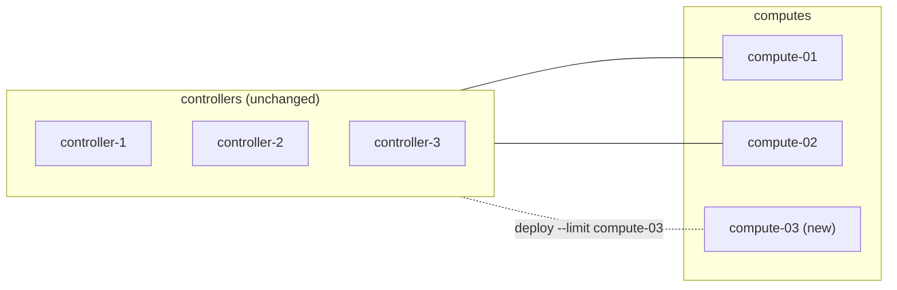

# Adding a compute node to a running Kolla-Ansible deployment

How to bring a new hypervisor into a deployment that already runs workloads: prepare the host, add it to the
inventory, deploy only to it, and prove it works before letting the scheduler place instances on it.

## Context

Adding capacity is the most frequent change made to a running Kolla-Ansible deployment, and usually the least
risky one: a compute node runs no clustered service, so nothing on the control plane has to change membership. The
risk comes from the commands around it. `bootstrap-servers` can restart Docker and every container of a host it
touches, and a `deploy` without `--limit` walks every host of the inventory and restarts whatever configuration it
finds changed.

This page follows the Kolla-Ansible 2026.1 guide *Adding and removing hosts*, and adds what an operator checks
before and after. It covers a libvirt/KVM compute node. Ironic compute services and new controllers are different
cases (a new controller changes the membership of MariaDB, RabbitMQ and other clusters; see the guide).

## Topology

Nothing changes on the controllers. The new host joins the `compute` group and gets the containers that group runs
in the inventory: `nova_compute`, `nova_libvirt`, `nova_ssh`, the Neutron agent of the chosen back-end
(`neutron_openvswitch_agent` and `openvswitch_*` with ML2/OVS, `ovn_controller` and `openvswitch_*` with ML2/OVN, plus
the OVN metadata agent), and the common containers (`fluentd`, `kolla_toolbox`, `cron`).



## Network design

The new host needs the same interfaces, with the same names, as the computes already deployed, or its own values in
`host_vars`: `network_interface` (and `api_interface` if separate), `tunnel_interface` for VXLAN or Geneve,
`neutron_external_interface` if computes carry provider networks or distributed floating IPs, and the storage
network if instances or volumes use Ceph. The MTU must match the rest of the deployment. See
[network interfaces, VLANs and MTU](../networking/interfaces-vlans-and-mtu-ovs-and-ovn.md).

The deploy host must reach it over SSH as the Ansible user, and the new host must reach the internal VIP, the
registry and, with Ceph, the monitors.

## Storage design

Nothing to change in Kolla-Ansible for a new compute: the Ceph client configuration and keyrings under
`/etc/kolla/config/nova/` are copied to every compute by the deploy. What to check is on the host itself: with a
local instance store, the disk or volume behind `/var/lib/docker/volumes/nova_compute` (or wherever the deployment
puts it) is prepared the same way as on the other computes.

## Inventory and configuration layout

Add the host to the `compute` group of the inventory, and to nothing else unless the deployment puts other roles
on computes (for example `network` with distributed routing, or `storage`):

```ini
[compute]
compute-01
compute-02
# new host
compute-03

# per-host values only when this host differs from the others, in host_vars/compute-03.yml
```

Keep the host name stable and unique: Nova registers the compute service under the host's node name, and Kolla-Ansible
waits for exactly that name to appear (see below). Reusing the name of a compute that was removed earlier needs the
old service record cleaned up first; see the Kolla-Ansible guide on removing compute nodes.

## Procedure

Run from the deploy host, with the Kolla-Ansible version that deployed the platform. Check it first: `pip show
kolla-ansible`, in the virtual environment Kolla-Ansible runs from, must give the series the running images come
from (`openstack_release` in `globals.yml`, or the image tags of `docker ps` on a running host).

**1. Read-only checks before the change.**

```bash
openstack compute service list --service nova-compute     # every existing compute up and enabled
openstack network agent list                              # every agent alive (ML2/OVS), or OVN controllers up
ansible -i <inventory> compute-03 -m ping                 # the deploy host reaches the new host
```

**2. Prepare the new host.** `bootstrap-servers` installs Docker and the host packages Kolla-Ansible needs, and
writes `/etc/hosts` entries.

> ⚠️ **State-changing.** Installs packages and configures Docker on the hosts in the limit. Limited to the new host,
> it changes nothing on the running ones. Without `--limit`, it runs on every host, can upgrade or restart Docker
> there and every container with it (the bootstrap servers guide, *Subsequent bootstrap considerations*). Never run it
> without a limit on a production deployment.

```bash
kolla-ansible bootstrap-servers -i <inventory> --limit compute-03
```

`customize_etc_hosts` (true by default) adds an entry for each host's API address to the `/etc/hosts` of the hosts in
the limit only. The existing hosts do not learn the new host's name this way. If anything on the platform resolves
compute host names through `/etc/hosts` rather than DNS, add the entry there yourself, or include them in a later,
batched `bootstrap-servers` run.

**3. Pull the images on the new host.** Read-only for the rest of the platform; it only downloads images.

```bash
kolla-ansible pull -i <inventory> --limit compute-03
```

**4. Run the prechecks on it.** Read-only.

```bash
kolla-ansible prechecks -i <inventory> --limit compute-03
```

**5. Deploy to the new host only.**

> ⚠️ **State-changing.** Creates and starts the compute containers on the new host and registers it with Nova.
> The running hosts are not reconfigured: with `--limit`, Kolla-Ansible still gathers facts from every host (its
> `gather-facts` play delegates fact gathering to the limited hosts) but only changes the hosts in the limit. The new
> hypervisor is enabled as soon as it registers, so the scheduler can place new instances on it at once. Undo: the
> removal procedure of the guide.

```bash
kolla-ansible deploy -i <inventory> --limit compute-03
```

Near the end of the Nova part, Kolla-Ansible waits for the new `nova-compute` service to register (20 tries, 10
seconds apart), then runs `nova-manage cell_v2 discover_hosts --by-service` in a cell conductor container so that the
host is mapped to its cell. You do not run `discover_hosts` yourself. If the service never registers, the deploy
fails on that host with `The following Nova compute services failed to register themselves: <host>`; read
`/var/log/kolla/nova/nova-compute.log` on the new host (most often it cannot reach RabbitMQ or the placement API, or
libvirt did not start).

**6. Verify, then test with an instance.**

```bash
openstack compute service list --service nova-compute --host compute-03   # up and enabled
openstack hypervisor list                                                 # compute-03 listed, state up
openstack network agent list --host compute-03                            # its agent alive
openstack resource provider list --name compute-03                        # a resource provider exists (osc-placement plugin)
```

> ⚠️ **State-changing.** Creates, then deletes, one test instance on the new host. Use a test project and a small
> flavor. Targeting a host with `nova:<host>` is an administrator action.

```bash
openstack server create --flavor <flavor> --image <image> --network <network> \
  --availability-zone nova:compute-03 test-compute-03
openstack server show test-compute-03 -c status -c addresses -c OS-EXT-SRV-ATTR:host
openstack server delete test-compute-03
```

The test instance reaches `ACTIVE`, gets its address, answers on the network and reaches its metadata, before
you delete it. Test right after the deploy: once a compute service is disabled, Nova marks its resource provider with the
`COMPUTE_STATUS_DISABLED` trait and the scheduler leaves it out, so a disabled host cannot be used for a test boot.

**7. If the test fails, take the host out of scheduling** while you look at it.

> ⚠️ **State-changing.** Stops the scheduler from placing new instances on this host. Instances already on it keep
> running. Undo: the same command with `--enable`.

```bash
openstack compute service set --disable --disable-reason "new host, failed test" compute-03 nova-compute
```

**8. Rebalance if needed.** New instances go to the new host through the scheduler's weighers; running instances do
not move by themselves. To move some, live-migrate them one at a time (the guide's example, administrator only):

> ⚠️ **State-changing.** Live-migrates a running instance: a short pause at the end of the migration, longer for
> instances with a lot of memory activity. Check the instance's flavor and storage allow it (see
> [where instance disks live](../storage/nova-instance-disks-local-ceph-rbd-or-boot-from-volume.md)).

```bash
openstack server migrate --live-migration --host compute-03 --os-compute-api-version 2.30 <server-id>
```

## Key choices and their consequences

| Choice | Alternative(s) | Why this one here | Consequence in operation |
|---|---|---|---|
| `--limit <new host>` on `bootstrap-servers`, `pull` and `deploy` | Run on the whole inventory | Nothing on the running hosts is touched; the upstream guide allows `--limit` with only the new hosts for computes | Configuration drift on other hosts (a changed `globals.yml` not yet applied) stays unapplied; the operating guide warns that `--limit` has known bugs in general, so keep it to this documented use |
| Deploy, not `reconfigure` | `reconfigure --limit` | The new host has no containers yet; `deploy` creates them | None for the existing hosts |
| Test before rebalancing | Let the scheduler fill the host at once | A host with a broken network or storage path fails every instance it gets | Takes a test instance and a few minutes |
| Several new computes in one run | One at a time | Same commands, `--limit compute-03,compute-04` | Fewer runs; a failure on one host does not stop the others (Kolla-Ansible fails only the host whose service did not register, unless `nova_compute_registration_fatal` is true) |

## What went wrong during deployment

Nothing observed yet: this page was written from the upstream guide and the 2026.1 roles, not from a run. Failures
that the 2026.1 code makes predictable:

- **`The following Nova compute services failed to register themselves`:** `nova_compute` did not register within
  about 200 seconds. Read `nova-compute.log` on the new host.
- **Facts missing for other hosts:** the `gather-facts` play gathers facts for every host through the limited ones;
  if a host of the inventory is unreachable, templates that need its address can fail. Fix or remove the unreachable
  host first.
- **A pull error on the new host only** (registry name, insecure registry, proxy): see
  [pull fails with "http: server gave HTTP response to HTTPS client"](../deployment-errors/pull-fails-http-response-to-https-client-insecure-registry.md).

## Version notes

Written against Kolla-Ansible 2026.1 (`stable/2026.1`): the `--limit` behaviour of the `gather-facts` play and the
registration wait in `ansible/roles/nova-cell/tasks/wait_discover_computes.yml` are read from that branch. The
procedure in the upstream guide has had the same shape for several releases; check the guide of your release.

## Lessons learned

- Check the Kolla-Ansible version on the deploy host before anything else: deploying a new compute with a newer
  Kolla-Ansible than the rest of the platform deploys newer images to it.
- Keep `--limit` on every command, and type the host name rather than a group, so that a typo fails instead of
  widening the run.
- Test with an instance before the scheduler sends real workloads.

## Validity and limits

- Written from the Kolla-Ansible 2026.1 documentation (*Adding and removing hosts*, *Bootstrap servers*, *Operating
  Kolla*) and code; not run on a lab for this page. Status `draft`.
- Covers libvirt/KVM computes. Not covered: Ironic compute services, new controllers or network nodes, cells (with
  `enable_cells`, the new host goes into its cell's compute group; see the Nova cells guide of Kolla-Ansible), and
  hosts with SR-IOV, PCI passthrough or GPUs, which need their own configuration before the deploy.
- The `/etc/hosts` remark follows from the bootstrap servers guide; whether anything on a given platform depends on
  those entries for computes was not tested.

## Related

- Kolla-Ansible 2026.1: [adding and removing hosts](https://docs.openstack.org/kolla-ansible/2026.1/user/adding-and-removing-hosts.html),
  [bootstrap servers](https://docs.openstack.org/kolla-ansible/2026.1/reference/deployment-and-bootstrapping/bootstrap-servers.html),
  [operating Kolla](https://docs.openstack.org/kolla-ansible/2026.1/user/operating-kolla.html) (the `--limit` warning)
- Nova 2026.1: [cells v2 and host discovery](https://docs.openstack.org/nova/2026.1/admin/cells.html)
- [Laying out the configuration](../configuration/inventory-globals-overrides-and-secrets-layout.md): inventory and
  `host_vars`

---

*Provenance: written by agent:ozarland-author, from the Kolla-Ansible 2026.1 documentation and code.
Reviewed in its pull request (see the page history). Checked by a human operator: not yet.*

**Worked for you, or not?** [Tell us in one line](https://github.com/OzarLand/kolla-ansible-deployment-patterns/issues/new?template=documentation-proposal.yml&page=operations/adding-a-compute-node.md&title=Feedback%3A+operations/adding-a-compute-node.md):
your release, your topology, and what happened.
