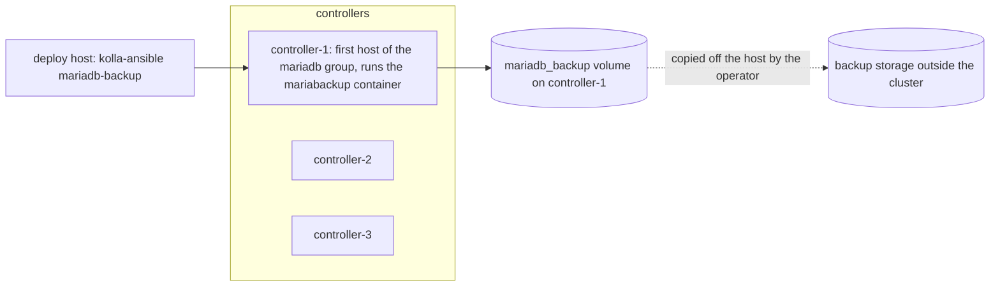

# Backing up and restoring the MariaDB cluster with kolla-ansible mariadb-backup

## Context

Every OpenStack service of a Kolla-Ansible deployment keeps its state in the MariaDB (Galera) cluster: instances,
volumes, networks, users, quotas. Galera replicates it across controllers, which protects against losing a node, not
against a bad `DELETE`, a failed schema migration during an upgrade, or losing every controller. For those, only a
backup taken outside the cluster helps.

Kolla-Ansible ships hot backups with Mariabackup: `kolla-ansible mariadb-backup` takes a full or incremental backup
without stopping the database. It does not schedule backups, does not copy them off the host, and does not restore
them: restoring is manual. This page says what the backup does, where the files land, how to restore a full or an
incremental backup, and what to check, following the Kolla-Ansible 2026.1 guide and code.

## Topology



## Network design

Not affected. The backup container connects to the MariaDB server of its own host, on `api_interface_address` and
`mariadb_port` (the `backup.my.cnf` template), not through the VIP.

## Storage design

- Backups land in the Docker volume `mariadb_backup` on the backup host only, by default the first host of the
  `mariadb` group (`mariadb_backup_host`). On Docker, its files are under
  `/var/lib/docker/volumes/mariadb_backup/_data/`.
- The volume is on the controller's own disk: plan its size (a full backup is about the size of the data, compressed)
  and copy every backup elsewhere. A backup that stays on the controller is lost with it.
- With several MariaDB shards, only the default shard (`mariadb_default_database_shard_id`) is backed up.

## Inventory and configuration layout

```yaml
# globals.yml
enable_mariabackup: "yes"
```

Then create the backup user and its grants on the running cluster:

> ⚠️ **State-changing.** Writes the Mariabackup configuration on the backup host, and creates the backup database
> user (`RELOAD`, `PROCESS`, `LOCK TABLES`, `BINLOG MONITOR`) and the `mariadb_backup_history` table. If the MariaDB
> configuration changed since the last run, the MariaDB containers restart one by one. Undo: set
> `enable_mariabackup` back to `"no"`; the user stays until you drop it.

```bash
kolla-ansible reconfigure -i <inventory> --tags mariadb
```

The password of the backup user is `mariadb_backup_database_password` in `passwords.yml`; nobody types it, since the
backup container reads it from its own configuration.

## Taking backups

```bash
kolla-ansible mariadb-backup -i <inventory>                 # full
kolla-ansible mariadb-backup -i <inventory> --incremental   # incremental, on top of the last full backup
```

These are hot backups: the guide says they take no downtime. The run starts a short-lived `mariabackup` container on
the backup host, with the same image as the running MariaDB server (Kolla-Ansible 2026.1 picks the image of the
running `mariadb` container on purpose, to avoid version mismatches). The backup is read-only for the platform, but
it adds read load on that controller's disks while it runs.

The guide suggests a daily full backup kept two weeks and hourly incrementals kept one day, scheduled outside
Kolla-Ansible (cron or a timer on the deploy host). Then copy the new files off the host, for example:

```bash
# on the backup host: list what is there
sudo ls -lh /var/lib/docker/volumes/mariadb_backup/_data/
```

Test a restore on a lab from time to time: an untested backup is a hope, not a backup.

## Restoring

> 🛑 **Destructive.** A restore replaces every OpenStack database with the backup's content. Everything written
> after the backup is lost: instances, volumes, ports and users created since then are unknown to OpenStack, while
> the hypervisors, Ceph and the network may still hold them. Every API is down from the stop to the end of the
> recovery. Only do it when the database is lost or corrupted beyond repair, after copying the current data aside
> (the `mariadb` volume of each node) so that you can go back, and with a decision recorded by whoever owns the
> platform. Compare with a Galera recovery first if the data is intact but the cluster is stopped:
> `kolla-ansible mariadb-recovery`.

The steps follow the Kolla-Ansible guide; run them on the first MariaDB host (the backup host). `<mariadb-image>` is
the image of the `mariadb` container: `sudo docker inspect mariadb --format '{{.Config.Image}}'`.

**1. Prepare the backup in a temporary container** (it reads the backup and writes a restorable copy under
`/backup/restore`, inside the `mariadb_backup` volume; the running database is not touched yet):

```bash
sudo docker run --rm -it --volumes-from mariadb --name dbrestore \
  --volume mariadb_backup:/backup <mariadb-image> /bin/bash

# inside the container
cd /backup
rm -rf /backup/restore && mkdir -p /backup/restore/full
gunzip <full-backup-file>.qp.xbc.xbs.gz
mbstream -x -C /backup/restore/full/ < <full-backup-file>.qp.xbc.xbs
mariabackup --prepare --target-dir /backup/restore/full
```

For an incremental backup, extract it too and apply it after the first `--prepare` (the guide's second example):

```bash
mkdir -p /backup/restore/inc
gunzip <incremental-backup-file>.qp.xbc.xbs.gz
mbstream -x -C /backup/restore/inc < <incremental-backup-file>.qp.xbc.xbs
mariabackup --prepare --incremental-dir=/backup/restore/inc --target-dir /backup/restore/full
```

**2. Stop MariaDB on every node.**

> 🛑 **Destructive.** Stops the database cluster: every OpenStack API fails until step 4 ends. Precondition: step 1
> succeeded (`mariabackup --prepare` ended with `completed OK!`).

```bash
kolla-ansible stop -i <inventory> --tags mariadb --yes-i-really-really-mean-it
```

**3. Replace the data on the first node.**

> 🛑 **Destructive.** Deletes the current database files of the first node and copies the backup in their place.
> Precondition: the current `mariadb` volume was copied aside (for example
> `sudo cp -a /var/lib/docker/volumes/mariadb/_data <safe place>`), and step 2 stopped every node.

```bash
sudo docker run --rm -it --volumes-from mariadb --name dbrestore \
  --volume mariadb_backup:/backup <mariadb-image> /bin/bash

# inside the container
rm -rf /var/lib/mysql/*
rm -rf /var/lib/mysql/\.[^\.]*
mariabackup --copy-back --target-dir /backup/restore/full
```

**4. Start the database again.**

- One MariaDB node: `sudo docker start mariadb`, then read `sudo docker logs mariadb`.
- A Galera cluster: bootstrap it from the restored node. The other nodes rejoin and copy the data from it (a full
  state transfer, as their own data is older).

> 🛑 **Destructive.** Starts a new Galera cluster from the first node's data; the data of the other nodes is
> replaced by it. Precondition: steps 1 to 3 succeeded on the node you name.

```bash
kolla-ansible mariadb-recovery -i <inventory> -e mariadb_recover_inventory_name=<first-mariadb-host>
```

## Key choices and their consequences

| Choice | Alternative(s) | Why this one here | Consequence in operation |
|---|---|---|---|
| Kolla-Ansible's Mariabackup | `mariadb-dump` of each database; storage snapshots | Hot, consistent, built in, same image as the server | Restore is manual and all-or-nothing; one database alone is easier to restore from a dump |
| Full plus incrementals | Full only | Smaller hourly backups | A restore needs the full backup and every incremental in order |
| Copy off the controller | Keep in the volume | A lost controller takes its volume with it | One more job to schedule and watch |
| Restore with `mariadb-recovery` and a named host | Bootstrap Galera by hand | The role sets `safe_to_bootstrap` and starts the others in order | It must be told the right host; without `mariadb_recover_inventory_name` it picks the node with the highest sequence number, which is not the restored one |

## What went wrong during deployment

Nothing observed for this page. Points that follow from the code and the guide:

- `mariadb-backup` does nothing unless `enable_mariabackup` is set and the `reconfigure --tags mariadb` ran: the play
  only runs the role `when: enable_mariabackup`.
- The backup is taken on `mariadb_backup_host` only; looking for files on another controller finds nothing.
- The guide's example image name ends in `-rocky-10`: use the image of your own `mariadb` container instead.

## Version notes

Kolla-Ansible 2026.1: the backup container uses the running server's image (bug 2058644). The guide still says the
backup reaches the cluster through the VIP; in 2026.1 the backup configuration names the backup host's own
`api_interface_address`.

## Lessons learned

- A backup on the controller is not a backup: copy it off, and check the copy.
- Practise the restore on a lab with the same release before you need it; time it.
- After a restore, OpenStack and the infrastructure disagree about everything created after the backup. Plan how to
  find those resources (instances on hypervisors, volumes in the storage back-end) before you restore.

## Validity and limits

- Written from the Kolla-Ansible 2026.1 guide (*MariaDB database backup and restore*, *MariaDB guide*) and the code of
  `ansible/mariadb-backup.yml`, `ansible/mariadb-recovery.yml` and `ansible/roles/mariadb/` (`backup.yml`,
  `config.yml`, `register.yml`, `recover_cluster.yml`, `templates/backup.my.cnf.j2`). Not run on a lab for this
  page. Status `draft`.
- Docker only; with Podman, replace `docker` and check the volume path.
- Not covered: several shards, external databases (`use_preconfigured_databases`), point-in-time recovery with binary
  logs, restoring one database alone.

## Related

- Kolla-Ansible 2026.1: [MariaDB backup and restore](https://docs.openstack.org/kolla-ansible/2026.1/admin/mariadb-backup-and-restore.html),
  [MariaDB guide](https://docs.openstack.org/kolla-ansible/2026.1/reference/databases/mariadb-guide.html)
- MariaDB: [Mariabackup overview](https://mariadb.com/kb/en/mariadb-backup-overview/)
- [Rotating the secrets in passwords.yml](../configuration/rotating-secrets-in-passwords-yml.md): take a backup before
  rotating database passwords.

---

*Provenance: written by agent:ozarland-author, from the Kolla-Ansible 2026.1 documentation and code.
Reviewed in its pull request (see the page history). Checked by a human operator: not yet.*

**Worked for you, or not?** [Tell us in one line](https://github.com/OzarLand/kolla-ansible-deployment-patterns/issues/new?template=documentation-proposal.yml&page=operations/mariadb-backup-and-restore-with-mariabackup.md&title=Feedback%3A+operations/mariadb-backup-and-restore-with-mariabackup.md):
your release, your topology, and what happened.
