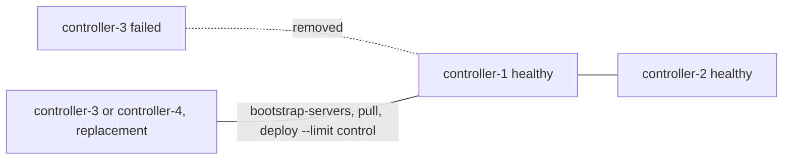

# Replacing a failed controller in a three-controller Kolla-Ansible deployment

## Context

One of three controllers is lost (hardware failure, a reinstalled disk) or must be rebuilt. The two others keep the
control plane running: Galera and RabbitMQ keep quorum with two of three members, HAProxy and keepalived move the VIP,
the API services answer from the remaining hosts. The cloud is degraded, not down, and one more failure would take
quorum away. The goal is to get back to three healthy members without touching the two that work.

This page follows the Kolla-Ansible 2026.1 guide *Adding and removing hosts* (sections on controllers), and adds the
decisions an operator meets: same name or new name, and what to check between steps. It does not cover losing two
controllers at once (no quorum: see the Galera recovery runbook) or replacing a compute node.

## Topology



## Network design

The replacement needs the same interfaces and addresses plan as the others (API network, tunnel, external if the
controllers carry network services, storage if they use Ceph). Reusing the failed host's API address simplifies
everything that was configured with addresses; a new address is fine as long as the inventory and `host_vars` say so.

## Storage design

Nothing to move: the data of the failed controller (Galera, RabbitMQ, Fernet keys) is replicated on the two others
and is copied to the replacement when it joins.

## Inventory and configuration layout

Two cases, decided before starting:

- **Same name:** the replacement takes the failed host's name (and usually its address). The inventory does not
  change. The failed host's records (network agents, compute services if it ran any, the stale RabbitMQ member) must
  be cleaned up before the replacement registers under the same name.
- **New name:** remove the failed host from every group, add the new one. The cluster memberships change, which needs
  a run on all controllers (`--limit control`).

## Procedure

**1. Read-only checks on the healthy controllers.** Do not start until both are healthy:

```bash
# Galera: cluster size 2, Primary, Synced; -p prompts for database_password from passwords.yml
sudo docker exec -it mariadb mariadb -uroot -p -e "SHOW STATUS WHERE Variable_name IN ('wsrep_cluster_size','wsrep_cluster_status','wsrep_local_state_comment');"
# RabbitMQ: the two healthy nodes running, the failed one listed as stopped
sudo docker exec rabbitmq rabbitmqctl cluster_status
# which routers and DHCP networks the failed host's agents held (ML2/OVS)
openstack network agent list --host <failed-host>
```

**2. Move what the failed host was serving (ML2/OVS).** With L3 HA (`enable_neutron_agent_ha`) routers fail over by
themselves; without it, the guide's loops move routers and DHCP networks from the dead agents to a healthy host (the
*Removing existing controllers* section). With ML2/OVN, gateways are rescheduled by OVN.

> ⚠️ **State-changing.** Reschedules routers and DHCP networks to another host's agents: a short interruption of
> routing and DHCP for the networks moved. Undo: move them back once the replacement is in place.

```bash
l3_id=$(openstack network agent list --host <failed-host> --agent-type l3 -f value -c ID)
target_l3_id=$(openstack network agent list --host <healthy-host> --agent-type l3 -f value -c ID)
openstack router list --agent $l3_id -f value -c ID | while read router; do
  openstack network agent remove router $l3_id $router --l3
  openstack network agent add router $target_l3_id $router --l3
done
```

(The guide gives the same loop for DHCP agents with `network list --agent` and `--dhcp`.)

**3. If the failed host is still reachable, stop its services** (the guide's command):

> ⚠️ **State-changing.** Stops every Kolla container on the failed host only. Undo: `kolla-ansible deploy --limit
> <failed-host>`, if the host is still usable.

```bash
kolla-ansible stop -i <inventory> --yes-i-really-really-mean-it --limit <failed-host>
```

**4. Remove the failed member from the clusters.**

> 🛑 **Destructive.** Removes the failed node from the RabbitMQ cluster membership; any queue whose only replica was
> on it is lost (it is lost anyway with the host). Precondition: the failed host is down or stopped (step 3), and its
> name is listed as a stopped member on the healthy nodes. Cannot be undone; the replacement joins as a new member.

```bash
# on one healthy controller
sudo docker exec rabbitmq rabbitmqctl forget_cluster_node rabbit@<failed-short-name>
```

Galera needs no command: a node that left is simply no longer part of the primary component, and the replacement
joins with a full state transfer. For the cluster configuration itself (the list of members in each node's
configuration), the guide's next step, a deploy on all controllers, rewrites it.

If the controller also ran `etcd`, set `etcd_remove_deleted_members: "yes"` in `globals.yml` before step 6, as the
guide says, or remove the member with `etcdctl`.

**5. Update the inventory.** Same name: no change. New name: replace the failed host by the new one in every group.

**6. Prepare and deploy the replacement, with all controllers in the limit.** The guide asks to include all
controllers (`--limit control`) for `bootstrap-servers` (RabbitMQ needs `/etc/hosts` entries for all controllers on
every controller) and for `deploy` (cluster memberships).

> ⚠️ **State-changing.** `bootstrap-servers` on the controllers can upgrade or restart Docker on the healthy ones too,
> and every container with it (the bootstrap servers guide, *Subsequent bootstrap considerations*). Run it in a
> maintenance window, and consider Docker's `live-restore` or an exact package pin first. Undo: none for a restart
> that happened.

```bash
kolla-ansible bootstrap-servers -i <inventory> --limit control
kolla-ansible pull -i <inventory> --limit <replacement-host>
```

> ⚠️ **State-changing.** Deploys the control plane containers on the replacement and reconfigures the cluster members
> on the healthy controllers: their containers restart where the configuration changed (MariaDB and RabbitMQ one by
> one, by the roles' handlers), briefly interrupting API calls through the restarted host. The replacement's MariaDB
> joins with a full state transfer from a healthy node, which loads it. Undo: none simple; the healthy controllers
> keep quorum during the run.

```bash
kolla-ansible deploy -i <inventory> --limit control
```

**7. Clean up the failed host's records.** With a new name, after step 6. With the same name, do this step before
step 6, so that the replacement registers its agents and services fresh instead of finding the failed host's records.

> 🛑 **Destructive.** Deletes the failed host's network agents and, if it ran any, its compute services from the
> APIs. Precondition: the host is gone for good and its services are stopped. Cannot be undone; a host that comes
> back registers again.

```bash
openstack network agent list --host <failed-host> -f value -c ID | while read id; do
  openstack network agent delete $id
done
openstack compute service list --os-compute-api-version 2.53 --host <failed-host> -f value -c ID | while read id; do
  openstack compute service delete --os-compute-api-version 2.53 $id
done
```

**8. Verify** with the checks of [checking a deployment after a change](checking-a-deployment-after-a-change.md):
Galera size 3, RabbitMQ with three running nodes, every agent alive, a test instance. Then rebalance routers and DHCP
networks onto the replacement if step 2 moved them.

## Key choices and their consequences

| Choice | Alternative(s) | Why this one here | Consequence in operation |
|---|---|---|---|
| Same name and address | A new host name | Nothing configured by address or name changes | The old records must be cleaned up before the new host registers |
| `--limit control` for `bootstrap-servers` and `deploy` | `--limit <replacement>` only | The guide requires all controllers: `/etc/hosts` for RabbitMQ, cluster memberships | The healthy controllers are touched too; maintenance window |
| Move routers before | Let L3 HA fail over | Without L3 HA, routers on the dead host stay down | A short interruption for the moved routers |
| Wait for both healthy controllers to be healthy | Start at once | One more failure during the procedure loses quorum | Time to check |

## What went wrong during deployment

Nothing observed for this page. Predictable traps: the replacement's MariaDB taking long to join (full state
transfer of the whole database); RabbitMQ refusing a node whose name is still a stale member (step 4); a
`bootstrap-servers` that upgrades Docker on the healthy controllers at the same time; Fernet keys distribution to the
new host (see the keystone runbook in `deployment-errors/` if it fails).

## Version notes

Written against Kolla-Ansible 2026.1. The `--limit control` rule and the router and DHCP loops are those of the 2026.1
guide; the guide also says to test any such procedure before production.

## Lessons learned

- Check that the two survivors are healthy before touching anything.
- Decide same name or new name first; it changes the inventory and the cleanup.
- Plan the window for `bootstrap-servers` on the controllers, not only for the deploy.

## Validity and limits

- Written from the Kolla-Ansible 2026.1 guide *Adding and removing hosts* and the bootstrap servers guide, with the
  RabbitMQ and Galera behaviour described in the deployment-error runbooks of this repository. Not run on a lab for
  this page. Status `draft`.
- Not covered: losing two controllers (no quorum), controllers that also hold Ceph monitors or other storage roles,
  separate network nodes (only the agents step changes), cells, and Podman.

## Related

- [Adding a compute node](adding-a-compute-node.md), [removing or replacing a compute node](removing-or-replacing-a-compute-node.md)
- [Checking a deployment after a change](checking-a-deployment-after-a-change.md)
- [Single control node versus three controllers](../comparisons/single-control-node-versus-three-controllers.md)
- Kolla-Ansible 2026.1: [adding and removing hosts](https://docs.openstack.org/kolla-ansible/2026.1/user/adding-and-removing-hosts.html),
  [bootstrap servers](https://docs.openstack.org/kolla-ansible/2026.1/reference/deployment-and-bootstrapping/bootstrap-servers.html)

---

*Provenance: written by agent:ozarland-author, from the Kolla-Ansible 2026.1 documentation.
Reviewed in its pull request (see the page history). Checked by a human operator: not yet.*

**Worked for you, or not?** [Tell us in one line](https://github.com/OzarLand/kolla-ansible-deployment-patterns/issues/new?template=documentation-proposal.yml&page=operations/replacing-a-failed-controller.md&title=Feedback%3A+operations/replacing-a-failed-controller.md):
your release, your topology, and what happened.
