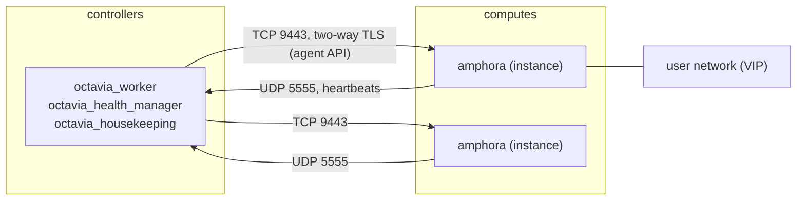

# Octavia with the amphora provider. Certificates, the management network and the amphora image

## Context

Octavia gives users load balancers. With the **amphora** provider, each load balancer is one Nova instance (two with
`ACTIVE_STANDBY`) running HAProxy, booted from an image you build, in the `service` project. The Octavia controllers
talk to those amphorae over a dedicated **management network**, with two-way TLS. Three things therefore have to be
right before the first load balancer works, and they are the three things this page is about:

1. the **certificates** that authenticate controllers and amphorae to each other;
2. the **management network**, which the controllers themselves must reach, not only the amphorae;
3. the **amphora image** in Glance, with the tag Octavia looks for.

With ML2/OVN, the **OVN** provider is an alternative that needs none of the three: it implements load balancers in
OVN itself, without instances, with fewer features (layer 4 only). Kolla-Ansible 2026.1 enables both providers when
`neutron_plugin_agent` is `ovn`. This page is about the amphora provider.

## Topology

The five Octavia containers run on the hosts of the `octavia` group, the controllers in the sample multinode
inventory: `octavia_api`, `octavia_worker`, `octavia_health_manager`, `octavia_housekeeping`, and
`octavia_driver_agent` with ML2/OVN. The amphorae are instances on the computes.



The worker drives each amphora's agent on TCP port 9443 (`octavia_amp_listen_port`); each amphora sends heartbeats to
the health managers on UDP port 5555 (`octavia_health_manager_port`). Both go over the management network.

## Network design

### The management network must reach the controllers

Kolla-Ansible 2026.1 has two modes, set by `octavia_network_type`:

| `octavia_network_type` | What Kolla-Ansible does | Upstream advice |
|---|---|---|
| `provider` (default) | Creates `lb-mgmt-net` as the provider network you describe in `octavia_amp_network`. The controllers reach it through `octavia_network_interface`, which you prepare on the host | "Typically a VLAN provider network is used" |
| `tenant` | Creates a tenant network, and on each controller a Neutron port plugged into `br-int` as the `o-hm0` interface, through an `octavia-interface` systemd unit | ML2/OVS only (a precheck fails otherwise); "do not use this option in production" |

In `provider` mode, `octavia_network_interface` defaults to `api_interface`. That default is rarely right: the
health managers listen on the address of that interface, and the amphorae must be able to send heartbeats to it from
the management subnet. Set it to an interface that has an address in the management subnet, usually a VLAN
sub-interface on the controllers, and make sure Neutron bridges the same VLAN on the controllers (the guide: "If using
a VLAN provider network, ensure that the traffic is also bridged to Open vSwitch on the controllers"). That means the
controllers carry the provider bridge for that physical network, and `enable_neutron_provider_networks: "yes"`.

```yaml
# globals.yml (provider mode, VLAN management network)
enable_octavia: "yes"
enable_valkey: "yes"                       # needed by the jobboard, see below
enable_neutron_provider_networks: "yes"
octavia_network_interface: "<vlan-subinterface-on-controllers>"   # has an address in the management subnet

octavia_amp_network:
  name: lb-mgmt-net
  provider_network_type: vlan
  provider_segmentation_id: <management-vlan-id>
  provider_physical_network: physnet1
  external: false
  shared: false
  subnet:
    name: lb-mgmt-subnet
    cidr: "198.51.100.0/24"
    allocation_pool_start: "198.51.100.100"   # the amphorae take addresses from this pool
    allocation_pool_end: "198.51.100.200"
    no_gateway_ip: true
    enable_dhcp: true
```

Keep the controllers' own addresses on that subnet outside the allocation pool, so Neutron never gives one of them
to an amphora. The default `octavia_amp_network` in 2026.1 has no provider settings and uses
`octavia_amp_network_cidr`, a private /24: it only works with a network design where that default is reachable,
which is seldom the case. Set it explicitly.

### Ports and security groups

With automatic registration, Kolla-Ansible creates `lb-mgmt-sec-grp` (ICMP, TCP 22, TCP 9443) for the amphorae, and,
in `tenant` mode only, `lb-health-mgr-sec-grp` (UDP 5555) for the controllers' ports. In `provider` mode the
controllers' interface is outside Neutron, so any host firewall on the controllers must let UDP 5555 in from the
management subnet.

## Storage design

Each amphora is an instance with the flavor `amphora` (1 vCPU, 1 GB RAM, 5 GB disk by default, `octavia_amp_flavor`),
so its disk lives wherever Nova puts instance disks. Count the load balancers when sizing: each one is one or two
instances in the `service` project, which also needs quotas large enough (instances, cores, RAM, ports, server
groups with `ACTIVE_STANDBY`).

## Inventory and configuration layout

```text
/etc/kolla/
  globals.yml                     # enable_octavia, enable_valkey, octavia_network_*, octavia_amp_*
  passwords.yml                   # octavia_ca_password, octavia_client_ca_password, octavia_keystone_password ...
  octavia-certificates/           # work directory of `kolla-ansible octavia-certificates` (CA keys)
  config/
    octavia/                      # what the deploy copies into the Octavia containers
      client_ca.cert.pem
      client.cert-and-key.pem
      server_ca.cert.pem
      server_ca.key.pem
    octavia.conf                  # optional overrides of octavia.conf
```

The four files under `config/octavia/` and the work directory hold private keys: keep them out of git, like
`passwords.yml` (see [laying out the configuration](../configuration/inventory-globals-overrides-and-secrets-layout.md)).
The precheck stops the deploy when one of the four is missing.

### Certificates: generated by Kolla-Ansible or brought in

Octavia uses two certificate authorities (Octavia certificate guide):

- the **server CA**, whose key Octavia keeps to sign a certificate for each amphora; amphorae present it to the
  controllers;
- the **client CA**, which signs the controllers' **client certificate**; each amphora checks the controllers against
  it.

> ⚠️ **State-changing.** Writes CA keys and certificates under `/etc/kolla/octavia-certificates/` and copies four files
> into `/etc/kolla/config/octavia/` on the deploy host. Nothing reaches the platform before a deploy or reconfigure.
> Re-running it does not replace files that already exist: each generation step is skipped when its output file is
> there.

```bash
kolla-ansible octavia-certificates -i <inventory>
```

The issuer fields come from `octavia_certs_country`, `octavia_certs_state`, `octavia_certs_organization` and
`octavia_certs_organizational_unit` in `globals.yml`. The validity periods come from the role's defaults
(`ansible/roles/octavia-certificates/defaults/main.yml` in 2026.1):

| File | Variable | Default validity |
|---|---|---|
| `server_ca.cert.pem` | `octavia_certs_server_ca_expiry` | 3650 days |
| `client_ca.cert.pem` | `octavia_certs_client_ca_expiry` | 3650 days |
| `client.cert-and-key.pem` | `octavia_certs_client_expiry` | **365 days** |

The client certificate expires after one year unless you change it. When it expires, the controllers can no longer
authenticate to any amphora: existing load balancers keep forwarding traffic, but nothing can be created, changed or
failed over. Check it regularly; this command is read-only and fails when a file expires within the given number of
days:

```bash
kolla-ansible octavia-certificates -i <inventory> --check-expiry 60
```

To bring your own certificates instead, follow the Octavia certificate guide and copy the four files to the names
above, with `octavia_ca_password` in `passwords.yml` matching the password of the server CA key (Kolla-Ansible
guide, option 2).

### Resources: registered by Kolla-Ansible or by you

With `octavia_auto_configure` true (the default with the amphora provider), the deploy creates the flavor, the SSH
keypair `octavia_ssh_key`, the management network and subnet, and the security groups, in the `service` project. It
needs the Nova and Neutron APIs to do so, also for `genconfig` and check mode. With `octavia_auto_configure: "no"`,
you create them yourself and give their IDs in `octavia_amp_boot_network_list`, `octavia_amp_secgroup_list` and
`octavia_amp_flavor_id` (the guide's option 2). The guide says to keep `octavia_auto_configure: "no"` on deployments
upgraded from Ussuri.

## Deploying it

**1. Read-only checks.** The management VLAN is trunked to the controllers and computes, and the controllers have
their address on it:

```bash
ip -br addr show <vlan-subinterface-on-controllers>      # on each controller: an address in the management subnet
openstack network agent list                             # agents alive on the controllers and computes
kolla-ansible prechecks -i <inventory>
```

**2. Deploy.** The guide deploys only the roles concerned:

> ⚠️ **State-changing.** Creates the Octavia database, Keystone service and endpoints, the Nova and Neutron resources
> above, and the Octavia containers; reconfigures HAProxy and Horizon. Existing services keep running. With
> `enable_valkey` just turned on, add `valkey` to the tags so the Valkey containers are deployed too. Undo: set
> `enable_octavia: "no"` and remove what was created (containers, endpoints, resources); there is no single undo
> command.

```bash
kolla-ansible deploy -i <inventory> --tags common,horizon,valkey,octavia
kolla-ansible post-deploy -i <inventory>        # writes /etc/kolla/octavia-openrc.sh
```

**3. Build and register the amphora image.** Build it with `diskimage-create.sh` from the Octavia source of the same
release (the guide lists the packages; `diskimage-builder` in a virtual environment), then upload it as the
`octavia` user:

> ⚠️ **State-changing.** Uploads a private image to Glance in the `service` project. Octavia uses the newest image
> with the tag `amphora` (`octavia_amp_image_tag`) for every new amphora. Undo: `openstack image delete`.

```bash
. /etc/kolla/octavia-openrc.sh
openstack image create amphora-x64-haproxy.qcow2 --container-format bare --disk-format qcow2 \
  --private --tag amphora --file amphora-x64-haproxy.qcow2 \
  --property hw_architecture='x86_64' --property hw_rng_model=virtio
```

**4. Verify with one load balancer.**

> ⚠️ **State-changing.** Creates, then deletes, a load balancer and its amphora in a test project.

```bash
openstack loadbalancer create --name lb-test --vip-subnet-id <user-subnet>
openstack loadbalancer show lb-test -c provisioning_status   # ACTIVE after a few minutes
openstack loadbalancer amphora list --loadbalancer lb-test                       # as admin: one amphora, its lb_network_ip
openstack loadbalancer delete lb-test
```

## Where to look when it fails

| Symptom | First log to read |
|---|---|
| Load balancer stays `PENDING_CREATE`, then `ERROR` | `/var/log/kolla/octavia/octavia-worker.log` on the controllers: the amphora boot (Nova, image, flavor, quota) and the connection to the agent on port 9443 |
| Amphora boots but the worker keeps retrying the connection | the worker cannot reach the amphora's management address: check the VLAN on the controllers and `octavia_network_interface` |
| Load balancer `ACTIVE` but `operating_status` stays `OFFLINE`, or amphorae fail over in a loop | `/var/log/kolla/octavia/octavia-health-manager.log`: no heartbeats arrive on UDP 5555 |
| Amphora certificates, image rotation, cleanup | `/var/log/kolla/octavia/octavia-housekeeping.log` |
| API errors | `/var/log/kolla/octavia/octavia-api.log`, and `docker logs octavia_api` (or `podman logs`) if the container does not start |
| `tenant` mode: `o-hm0` has no address | `journalctl -u octavia-interface` on the controller |

From a controller, the guide's way to look inside an amphora is SSH with the key Kolla-Ansible deploys:

```bash
ssh -i /etc/kolla/octavia-worker/octavia_ssh_key ubuntu@<amphora-lb-network-ip>
```

The amphora's console log (`openstack console log show <amphora-compute-id>`, as admin) shows whether it booted and
reached its agent, when SSH does not work.

## Key choices and their consequences

| Choice | Alternative(s) | Why this one here | Consequence in operation |
|---|---|---|---|
| Amphora provider | OVN provider (ML2/OVN only) | Layer 7 policies, TLS termination, HAProxy features | One or two instances per load balancer to size, patch (image rotation) and monitor |
| `provider` network type, VLAN | `tenant` (lab only, ML2/OVS only) | The upstream recommendation; no dependency on a Neutron port per controller | A VLAN to trunk to controllers and computes, and an interface to prepare on each controller |
| Certificates generated by `kolla-ansible octavia-certificates` | Your own CAs (guide, option 2) | Simplest, files in the expected names | The client certificate expires after 365 days by default: plan its renewal, or set `octavia_certs_client_expiry` longer before generating |
| `SINGLE` topology (default) | `ACTIVE_STANDBY` (`octavia_loadbalancer_topology`) | Half the instances | A failover or an image rotation interrupts a load balancer briefly; `ACTIVE_STANDBY` avoids that "without any measurable interruption" according to the Octavia maintenance guide |
| Jobboard on (default with amphora) | `enable_octavia_jobboard: "no"` | Another controller resumes a flow when one dies, instead of leaving resources in `PENDING_*` | Valkey must be enabled; the precheck fails with "Valkey must be enabled when using Octavia Jobboard" otherwise |

## What went wrong during deployment

Nothing observed yet: this page was written from the documentation and the 2026.1 roles. Failures the 2026.1 code
makes predictable:

- **Precheck: `Valkey must be enabled when using Octavia Jobboard`.** The jobboard is on by default with the amphora
  provider and `enable_valkey` is off by default. Enable Valkey, or turn the jobboard off.
- **Precheck: a certificate file is not found.** One of the four files under `/etc/kolla/config/octavia/` is missing;
  run `kolla-ansible octavia-certificates` or copy your own.
- **Precheck: `Neutron plugin agent ... is not supported when octavia_network_type is tenant`.** `tenant` mode with
  ML2/OVN.
- **`tenant` mode on a large deployment: `octavia-interface.service` fails** because the OVS agent sync takes longer
  than the wait; the guide raises `octavia_interface_wait_timeout` (for example 1800 seconds).

## Version notes

- 2026.1: the jobboard depends on **Valkey**, which replaced Redis in Kolla-Ansible; the release note that made the
  jobboard default still names Redis. On an upgrade from a release where Redis was enabled for Octavia, see the
  [2025.1 to 2026.1 notes](../version-notes/2025.1-to-2026.1.md).
- Since Victoria, Kolla-Ansible generates the certificates and registers the resources; older deployments upgraded
  from Ussuri keep `octavia_auto_configure: "no"`.

## Renewing what expires

- **Amphora (server) certificates:** Octavia's housekeeping process rotates them before they expire (Octavia
  certificate guide). Nothing to do while the server CA stays the same.
- **The controllers' client certificate:** the Octavia maintenance guide says to issue a new one from the same client
  CA, install it, and restart every Octavia service except `octavia-api`. With Kolla-Ansible, that means a new
  `client.cert-and-key.pem` under `/etc/kolla/config/octavia/`, then a reconfigure of Octavia. Because
  `kolla-ansible octavia-certificates` skips files that exist, it does not renew an existing client certificate by
  itself; how to make it issue a new one from the same CA is not documented by Kolla-Ansible and was not tested here.
  If the client **CA** changes too, the amphorae no longer trust the controllers until every amphora is failed over
  (Octavia maintenance guide).

> ⚠️ **State-changing.** Copies the new certificate into the Octavia containers and restarts those whose
> configuration changed. Running load balancers keep forwarding traffic; operations in progress may be retried by
> the jobboard. Precondition: the new certificate is signed by the client CA the amphorae already have.

```bash
kolla-ansible reconfigure -i <inventory> --tags octavia
```

- **The amphora image:** rebuild it for OS or HAProxy updates, upload it with the same tag, then fail over the
  existing amphorae, as the Octavia maintenance guide's *Rotating the amphora images* describes. New amphorae use
  the new image at once.

## Lessons learned

No first-hand lessons yet. What the sources make clear:

- Decide the management network first: it is the part that most often blocks the first load balancer, and the
  default `octavia_network_interface` points to the API interface.
- Put `--check-expiry` in your monitoring or calendar: the default client certificate lasts one year.
- Test with one load balancer right after the deploy, before users create theirs.

## Validity and limits

Written from Kolla-Ansible 2026.1 (Octavia guide, `ansible/group_vars/all/octavia.yml`, the `octavia` and
`octavia-certificates` roles) and the Octavia 2026.1 documentation (certificate guide, operator maintenance guide).
Not run on a lab: no command output on this page was observed. Not covered: the OVN provider in detail, Octavia
flavors and availability zones, TLS-terminated listeners with Barbican, log offloading, SR-IOV VIPs, and IPv6
management networks.

## Related

- [Provider networks with Kolla-Ansible](../networking/provider-networks-instances-on-flat-or-vlan-networks.md):
  bridges and physical networks, also needed on the controllers here.
- [Network interfaces, VLANs and MTU](../networking/interfaces-vlans-and-mtu-ovs-and-ovn.md)
- [ML2/OVS versus ML2/OVN](../comparisons/ml2-ovs-versus-ml2-ovn-with-kolla-ansible.md): which Octavia providers each
  allows.
- Kolla-Ansible 2026.1: [Octavia guide](https://docs.openstack.org/kolla-ansible/2026.1/reference/networking/octavia.html)
- Octavia 2026.1: [certificates](https://docs.openstack.org/octavia/2026.1/admin/guides/certificates.html),
  [operator maintenance](https://docs.openstack.org/octavia/2026.1/admin/guides/operator-maintenance.html),
  [amphorav2 and the jobboard](https://docs.openstack.org/octavia/2026.1/install/install-amphorav2.html)

---

*Provenance: written by agent:ozarland-author, from the Kolla-Ansible and Octavia 2026.1 documentation and the
Kolla-Ansible 2026.1 code. Reviewed in its pull request (see the page history). Checked by a human operator: not yet.*

**Worked for you, or not?** [Tell us in one line](https://github.com/OzarLand/kolla-ansible-deployment-patterns/issues/new?template=documentation-proposal.yml&page=services/octavia-amphora-certificates-and-management-network.md&title=Feedback%3A+services/octavia-amphora-certificates-and-management-network.md):
your release, your topology, and what happened.
