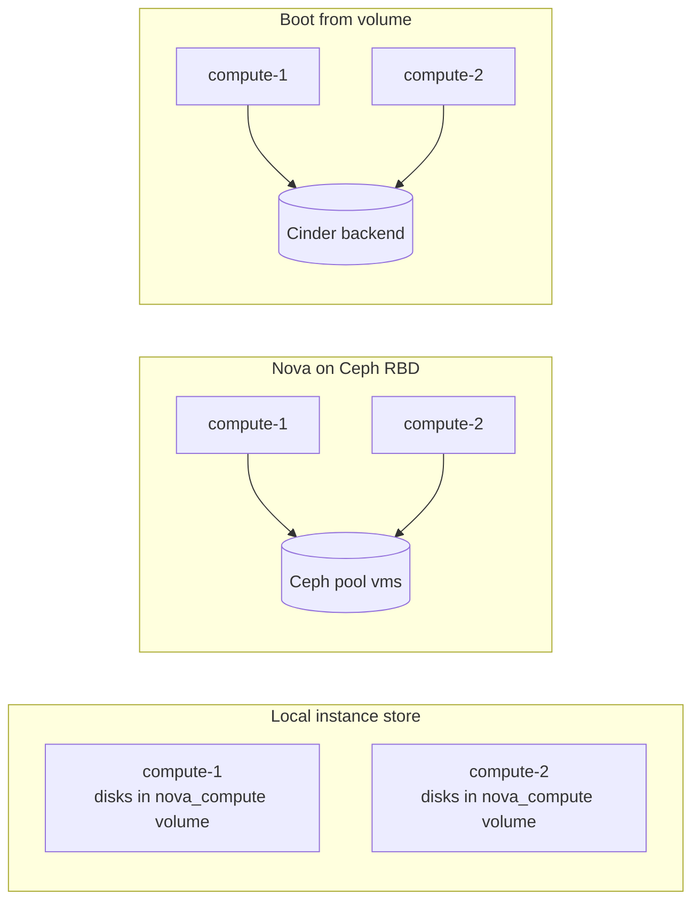

# Where instance disks live. Local on each compute, in Ceph RBD, or boot from volume

## Context

Every instance has a root disk, and some have ephemeral and swap disks. Nova can keep them in three places, and the
choice decides what happens on the worst days: when a compute dies, when it must be drained for maintenance, when its
disk fills up.

- **Local instance store** (Kolla-Ansible's default): the disks are files on each compute.
- **Ceph RBD for Nova** (`nova_backend_ceph: "yes"`): the disks are RBD images in a Ceph pool, `vms` by default.
- **Boot from volume:** the root disk is a Cinder volume, on whatever backend Cinder uses. This is per instance (the
  user or the flavor workflow chooses it), not a platform switch, and it can be combined with either of the other two
  for the instances that do not boot from a volume.

The [Cinder and Glance back-ends page](cinder-and-glance-backends-compared-lvm-ceph-nfs.md) compares the volume and
image stores; this page is about the instance disks themselves.

## Topology

No change in roles: the choice changes where `nova-compute` and `nova_libvirt` read and write disks.



## Network design

- **Local store:** disks do not cross the network in normal operation. A live migration copies them (block
  migration), over the migration network, with the memory.
- **Ceph RBD and boot from volume:** every disk read and write crosses the storage network to Ceph or to the Cinder
  backend. The computes need a fast, redundant path to it; a storage network outage stalls the I/O of every instance
  on that compute.

## Storage design

| | Local instance store | Nova on Ceph RBD | Boot from volume |
|---|---|---|---|
| Where the root disk is | A file under `/var/lib/nova/instances` inside the containers. With Kolla-Ansible's containerised libvirt, that is the `nova_compute` Docker volume (`nova_instance_datadir_volume`), so on the host under `/var/lib/docker/volumes/nova_compute/_data` | An RBD image in the pool `ceph_nova_pool_name` (default `vms`), through `[libvirt] images_type = rbd`, which Kolla-Ansible sets when `nova_backend` is `rbd` | A Cinder volume, attached by `nova-compute` through `os-brick` |
| Disk format | `qcow2` overlays on a cached base image by default (Nova's `qcow2` backing store), or `flat` | RBD images; cloned copy-on-write from the Glance image when Glance is on the same Ceph and the image is `raw` | Whatever the Cinder backend uses |
| Capacity | Each compute's own disk; one compute can be full while others have room | One pool for all computes, sized and monitored in Ceph | The Cinder backend, counted in Cinder quotas |
| What a compute failure does to the disks | They stay on the dead host | They stay in Ceph | They stay on the Cinder backend |

What the Kolla-Ansible external Ceph guide asks for, with Ceph:

```yaml
# globals.yml
nova_backend_ceph: "yes"
ceph_nova_user: "<user>"              # defaults to ceph_cinder_user
ceph_nova_pool_name: "vms"
```

with `/etc/kolla/config/nova/ceph.conf` and the keyring `ceph.client.<user>.keyring` beside it, or per host under
`/etc/kolla/config/nova/<hostname>/` with `ceph_cluster` set in the inventory, to give different computes different
Ceph clusters (for example one per availability zone). For copy-on-write clones from Glance, the same guide sets
`show_image_direct_url = True` in `/etc/kolla/config/glance.conf`, and warns that this option can be a security risk
when Glance has other backends than Ceph.

Ceph's OpenStack guide recommends `raw` images in Glance to boot instances from Ceph, ephemeral or volume: a `qcow2`
image cannot be cloned and is downloaded and converted instead.

## Inventory and configuration layout

No new inventory group. The choice is global (`nova_backend_ceph` in `globals.yml`), or per compute when several Ceph
clusters are used (`ceph_cluster` per host). The Ceph keyrings are secrets: keep them out of git, as the
[configuration layout pattern](../configuration/inventory-globals-overrides-and-secrets-layout.md) describes.

## Key choices and their consequences

| Choice | Alternative(s) | Why one would choose it | Consequence in operation |
|---|---|---|---|
| Local instance store | Ceph RBD, boot from volume | No storage cluster to run; local disk latency; Kolla-Ansible's default | **Live migration copies the disks** (block migration: more time, more network and storage load, and, per Nova's guide, incompatible with read-only devices such as CD-ROMs and config drives). **Evacuation rebuilds the root disk from its image**: the data written in the instance is lost (Nova's evacuate guide: shared storage is what preserves it). A full compute disk pauses the instances that write. |
| Nova on Ceph RBD | Local, boot from volume | Disks survive a compute failure; migrations do not copy disks (external Ceph guide); one pool to size instead of one disk per compute | A Ceph cluster to deploy and operate outside Kolla-Ansible. Every instance's I/O depends on the storage network and on Ceph's health. Images should be `raw` in Glance for copy-on-write. |
| Boot from volume | Local, Ceph RBD | Per instance: the instances that must keep their disk get it, without changing the platform | Root disks count against Cinder quotas and depend on Cinder at build time (see [instance fails to boot from volume](https://github.com/OzarLand/openstack-vm-runbooks/blob/main/scheduling/instance-fails-to-boot-from-volume.md)). The disk survives a compute failure and live migration does not copy it. |
| Local store, but Glance on Ceph | Glance on `file` | Faster image downloads to the computes | Nova's KVM guide describes `[glance] enable_rbd_download = true` on the computes with `show_image_direct_url` on Glance, to fetch images by RBD export instead of the Glance API. |

## What went wrong during deployment

Nothing recorded for this page. Two lab records in the runbooks show the local store's consequences:

- **Evacuation:** on a two-compute lab with local disks, an evacuated instance with a local disk was rebuilt from its
  image, while a boot-from-volume instance kept its disk
  ([fence before evacuate](https://github.com/OzarLand/openstack-vm-runbooks/blob/main/recovery/compute-host-failure-fence-before-evacuate.md),
  lab confirmation of 2026-10-23).
- **Full disk:** with the instance store on a dedicated 5 GB file system filled by a stray file, an instance that
  wrote was paused while Nova still showed it `ACTIVE`; `df` on the Docker volume path needed `sudo`
  ([compute disk full](https://github.com/OzarLand/openstack-vm-runbooks/blob/main/lifecycle/compute-disk-full-instance-paused.md)).

## Version notes

- 2026.1: `nova_backend` is derived from `nova_backend_ceph` (`group_vars/all/nova.yml`), and `images_type = rbd` is
  written only for `rbd` (`libvirt.conf.j2`); read in Kolla-Ansible's `stable/2026.1`.
- Nova's `raw` images type is deprecated in favour of `flat` (Nova's KVM guide).

## Lessons learned

No first-hand lessons on Ceph for this page. What the sources and the lab records stress:

- Decide before production which instances must survive the loss of their compute. With the local store, only those
  booted from a volume do.
- With the local store, monitor each compute's instance store, not only the cluster's totals: the lab's full-disk
  case froze instances on one compute while the others were fine.
- With Ceph, Glance images in `raw` are what makes boots fast; a `qcow2` image costs a download and a conversion on
  every new disk.

## Validity and limits

Written from the Kolla-Ansible 2026.1 external Ceph guide and source (`group_vars/all/nova.yml`, `nova-cell` role),
Nova 2026.1 (KVM, live migration and evacuation guides) and Ceph's OpenStack guide, with two lab records from the
runbooks repository, both on the local store. Nova on Ceph RBD was not deployed for this page.

Not covered: LVM as Nova's images type, NFS-shared instance stores, Ceph pool sizing and replication, encryption of
ephemeral disks, images with `hw_disk_bus` or `hw_scsi_model` properties, and image caching settings on the computes.

## Related

- [Cinder and Glance back-ends compared](cinder-and-glance-backends-compared-lvm-ceph-nfs.md)
- Runbooks: [fence before evacuate](https://github.com/OzarLand/openstack-vm-runbooks/blob/main/recovery/compute-host-failure-fence-before-evacuate.md),
  [compute disk full](https://github.com/OzarLand/openstack-vm-runbooks/blob/main/lifecycle/compute-disk-full-instance-paused.md),
  [moving instances off a host for maintenance](https://github.com/OzarLand/openstack-vm-runbooks/blob/main/migration/moving-instances-off-a-host-for-maintenance.md),
  [instance fails to boot from volume](https://github.com/OzarLand/openstack-vm-runbooks/blob/main/scheduling/instance-fails-to-boot-from-volume.md)
- Kolla-Ansible 2026.1: [external Ceph guide](https://docs.openstack.org/kolla-ansible/2026.1/reference/storage/external-ceph-guide.html)
- Nova 2026.1: [KVM](https://docs.openstack.org/nova/2026.1/admin/configuration/hypervisor-kvm.html),
  [configuring migrations](https://docs.openstack.org/nova/2026.1/admin/configuring-migrations.html),
  [evacuate](https://docs.openstack.org/nova/2026.1/admin/evacuate.html)
- Ceph: [block devices and OpenStack](https://docs.ceph.com/en/latest/rbd/rbd-openstack/)

---

*Provenance: written by agent:ozarland-author, from the Kolla-Ansible, Nova and Ceph documentation and Kolla-Ansible
source, with two lab records from the runbooks repository.
Reviewed in its pull request (see the page history). Checked by a human operator: not yet.*

**Worked for you, or not?** [Tell us in one line](https://github.com/OzarLand/kolla-ansible-deployment-patterns/issues/new?template=documentation-proposal.yml&page=storage/nova-instance-disks-local-ceph-rbd-or-boot-from-volume.md&title=Feedback%3A+storage/nova-instance-disks-local-ceph-rbd-or-boot-from-volume.md):
your release, your topology, and what happened.
