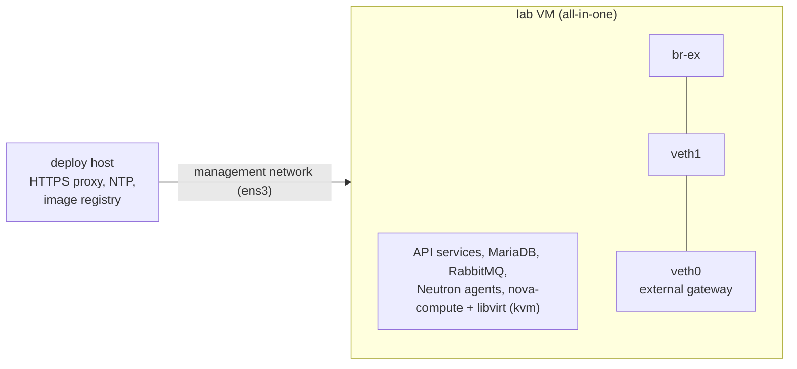

# All-in-one lab on a single VM, nested inside an existing OpenStack cloud

A complete OpenStack 2026.1 (Keystone, Glance, Nova, Neutron with Open vSwitch, Placement, Heat, Horizon) on one VM
of an existing cloud, deployed with Kolla-Ansible's `all-in-one` inventory. It is the smallest lab that still boots
real instances under KVM and gives them floating IPs. It was built in about 70 minutes, including about 17 minutes
of image pull, and two errors had to be fixed on the way; both are described below with their fix.

## Context

- **Purpose.** A first lab: learn how Kolla-Ansible lays out a deployment, and try runbooks on something that can be
  broken and rebuilt. It does not need HA; it needs to be cheap, quick to rebuild, and close to Kolla-Ansible's
  defaults.
- **Constraints of the hosting cloud** (the same as for the
  [multinode pattern](three-controllers-two-computes-nested-in-an-openstack-cloud.md)): project networks with an MTU
  of 1442; nested virtualisation available inside instances; no Internet egress for ports without a floating IP;
  outbound TCP 80 blocked. An existing deploy host on the same project network provides an HTTPS proxy, an NTP server
  and a local registry holding the Kolla images under a tag that never moves.
- **Budget.** One VM of 4 vCPU, 16 GB of RAM and a 50 GB root disk.
- **Skills.** Anyone who can follow Kolla-Ansible's quickstart; nothing here goes beyond it except what the hosting
  cloud forces.

## Topology



| Role | Count | Size | Runs |
|---|---|---|---|
| All-in-one node | 1 | 4 vCPU, 16 GB RAM, 50 GB disk, one NIC | every service of Kolla-Ansible's `all-in-one` inventory: control, network, compute, monitoring and deployment groups; kolla-ansible itself runs on the node, from a virtual environment |
| Deploy host | 1 | existing machine | only serves the lab: HTTPS proxy, NTP, image registry |

## Network design

| Interface | Kolla-Ansible role | Notes |
|---|---|---|
| `ens3` (the VM's only port, on the project network) | `network_interface`: internal API, service traffic, and the "VIP" | port security enabled; the lab VM's security group allows SSH and ICMP from the deploy host only |
| `veth1` | `neutron_external_interface`, plugged into `br-ex` | one end of a local veth pair, created persistently with systemd-networkd |
| `veth0` | none | the other end; carries the gateway address of the lab's external network, so that the node reaches floating IPs |

- **No second port for the external network.** A veth pair gives Kolla-Ansible the address-less interface it wants
  for `br-ex`, without a second port and without disabling port security anywhere. The price: floating IPs are only
  reachable from the node itself.
- **No HAProxy, keepalived or ProxySQL.** With one node there is nothing to fail over to; `enable_haproxy: "no"`,
  `enable_proxysql: "no"`, and `kolla_internal_vip_address` set to the node's own address. ProxySQL must be disabled
  explicitly in 2026.1 (see [what went wrong](#what-went-wrong-during-deployment)).
- **MTU.** The hosting cloud's 1442 bytes, given to Neutron with an override, `/etc/kolla/config/neutron.conf`:
  ```ini
  [DEFAULT]
  global_physnet_mtu = 1442
  ```
- **Egress.** apt, pip, `kolla-ansible install-deps`, Docker and the containers all go through the deploy host's
  HTTPS proxy; the images come from its registry, without the proxy.

## Storage design

No Cinder, no Ceph. Glance stores images in a Docker volume on the node, and Nova keeps instance disks on the node's
root file system, so a lab that fills the disk fills it for every service. Enough for CirrOS instances; give the VM a
larger disk, or a separate volume for the instance store, before trying larger images.

## Inventory and configuration layout

```text
~/kolla-venv/            kolla-ansible 22.2.0 and ansible-core 2.20.10, plus docker and dbus-python (see below)
~/all-in-one             Kolla-Ansible's all-in-one inventory, unchanged (localhost, ansible_connection=local)
/etc/kolla/
  globals.yml            the values below, and nothing else
  passwords.yml          generated by kolla-genpwd, never copied anywhere
  config/
    neutron.conf         global_physnet_mtu
```

Values that differ from Kolla-Ansible's defaults:

| Setting | Default | Here | Why |
|---|---|---|---|
| `enable_haproxy` | `yes` | `no` | one node, no VIP to fail over |
| `enable_proxysql` | `yes` | `no` | otherwise it takes port 3306 on the node's address and MariaDB cannot start |
| `kolla_internal_vip_address` | none | the node's address | no VIP without HAProxy and keepalived |
| `network_interface`, `neutron_external_interface` | `eth0`, `eth1` | `ens3`, `veth1` | the VM's interface names; the veth pair above |
| `global_physnet_mtu` (Neutron, override) | 1500 | 1442 | the hosting cloud's MTU |
| `docker_registry`, `docker_registry_insecure`, `openstack_tag` | quay.io, moving tag | the deploy host's registry, plain HTTP, a pinned tag | pinned images |
| `docker_*_proxy`, `container_*_proxy`, `docker_apt_key_env` | unset | the deploy host's proxy | the only egress |
| `docker_client_timeout` | 120 | 600 | pulls through one shared proxy |

Everything else keeps Kolla-Ansible's defaults (`neutron_plugin_agent: openvswitch`, `nova_compute_virt_type: kvm`,
`kolla_container_engine: docker`).

## Build it step by step

Placeholders: `<deploy-host>` (192.0.2.10) is the deploy host; `<lab-vm>` (192.0.2.25) is the all-in-one VM, on the
project network `<mgmt-network>`; `<cloud>` is the hosting cloud's `clouds.yaml` entry; `<flavor-4c16g>` a flavor
with 4 vCPU, 16 GB of RAM and a 50 GB disk.

### 1. Create the VM (on the deploy host, against the hosting cloud)

> ⚠️ **State-changing.** Creates a key pair, a security group, a port and a server in your project of the hosting
> cloud, and uses quota there. Check the quota first. Undo with the commands of
> [delete the lab](#delete-the-lab).

```bash
export OS_CLOUD=<cloud>
S=~/.lab/<lab-vm>; mkdir -p $S && chmod 700 $S
ssh-keygen -q -t ed25519 -N '' -C <lab-vm> -f $S/id_ed25519
openstack keypair create --public-key $S/id_ed25519.pub <lab-vm>
openstack security group create <lab-vm>-sg
openstack security group rule create <lab-vm>-sg --protocol tcp --dst-port 22 --remote-ip 192.0.2.10/32
openstack security group rule create <lab-vm>-sg --protocol icmp --remote-ip 192.0.2.10/32
openstack port create --network <mgmt-network> --security-group <lab-vm>-sg <lab-vm>-mgmt
openstack image list --status active -f value -c Name | grep -i '24\.04'   # the exact image name on your cloud
openstack server create --flavor <flavor-4c16g> --image '<ubuntu-24.04-image>' \
  --port <lab-vm>-mgmt --key-name <lab-vm> --config-drive true --wait <lab-vm>
```

`--config-drive true` because, on this cloud, the SSH key did not always reach instances through the metadata
service. The VM was active in about 2 minutes. Before going further, check nested virtualisation: if `/dev/kvm` is
missing in the VM, set `nova_compute_virt_type: qemu` later.

```bash
ssh -i $S/id_ed25519 ubuntu@192.0.2.25 'ls -l /dev/kvm; grep -cE "vmx|svm" /proc/cpuinfo; cloud-init status --wait'
```

Every following command runs on the lab VM.

### 2. Prepare the host

> ⚠️ **State-changing.** Changes the lab VM only: apt proxy and sources, automatic upgrades turned off, NTP source,
> a new veth pair.

```bash
printf 'Acquire::http::Proxy "http://192.0.2.10:3128";\nAcquire::https::Proxy "http://192.0.2.10:3128";\n' \
  | sudo tee /etc/apt/apt.conf.d/90proxy
sudo sed -i 's#http://[^ ]*ubuntu.com/ubuntu/\?#https://archive.ubuntu.com/ubuntu/#' /etc/apt/sources.list.d/ubuntu.sources

sudo systemctl disable --now unattended-upgrades apt-daily.timer apt-daily-upgrade.timer
printf 'APT::Periodic::Update-Package-Lists "0";\nAPT::Periodic::Unattended-Upgrade "0";\n' \
  | sudo tee /etc/apt/apt.conf.d/20auto-upgrades

sudo mkdir -p /etc/systemd/timesyncd.conf.d
printf '[Time]\nNTP=192.0.2.10\n' | sudo tee /etc/systemd/timesyncd.conf.d/90-lab.conf
sudo systemctl restart systemd-timesyncd && timedatectl show -p NTPSynchronized   # NTPSynchronized=yes
sudo apt-get update

printf '[NetDev]\nName=veth0\nKind=veth\n[Peer]\nName=veth1\n' | sudo tee /etc/systemd/network/25-veth-ext.netdev
printf '[Match]\nName=veth0\n[Network]\nAddress=198.51.100.1/24\nLinkLocalAddressing=no\n' | sudo tee /etc/systemd/network/25-veth0.network
printf '[Match]\nName=veth1\n[Network]\nLinkLocalAddressing=no\n' | sudo tee /etc/systemd/network/25-veth1.network
sudo networkctl reload && ip -br a show veth0 && ip -br a show veth1
```

Right after the reload both ends may still show `DOWN` without an address; a few seconds later `veth0` is `UP` with
`198.51.100.1/24` and `veth1` is `UP` without an address.

Automatic upgrades are turned off because they once upgraded `libc6` and `systemd` in the middle of a deploy
([deployment error page](../deployment-errors/unattended-upgrades-during-deploy-breaks-the-mariadb-cluster.md)).

### 3. Install Kolla-Ansible

The Kolla-Ansible series must match the images: 22.x for 2026.1.

```bash
sudo apt-get install -y git python3-dev python3-venv libffi-dev gcc libssl-dev libdbus-glib-1-dev
export https_proxy=http://192.0.2.10:3128 http_proxy=http://192.0.2.10:3128
python3 -m venv ~/kolla-venv && source ~/kolla-venv/bin/activate
pip install -U pip
pip install 'ansible-core==2.20.10' 'kolla-ansible==22.2.0'
pip install docker dbus-python          # needed on an all-in-one, see "What went wrong"
kolla-ansible install-deps

sudo mkdir -p /etc/kolla/config && sudo chown -R $USER: /etc/kolla
cp ~/kolla-venv/share/kolla-ansible/etc_examples/kolla/* /etc/kolla/
cp ~/kolla-venv/share/kolla-ansible/ansible/inventory/all-in-one ~/all-in-one
kolla-genpwd
```

### 4. Configure

Replace `/etc/kolla/globals.yml` with:

```yaml
kolla_base_distro: "ubuntu"
kolla_container_engine: "docker"
enable_haproxy: "no"
enable_proxysql: "no"
kolla_internal_vip_address: "192.0.2.25"
network_interface: "ens3"
neutron_external_interface: "veth1"
neutron_plugin_agent: "openvswitch"
nova_compute_virt_type: "kvm"
docker_registry: "192.0.2.10:4000"
docker_registry_insecure: true
openstack_tag: "2026.1-ubuntu-noble-<date>"
docker_client_timeout: 600
docker_http_proxy: "http://192.0.2.10:3128"
docker_https_proxy: "http://192.0.2.10:3128"
docker_no_proxy: "localhost,127.0.0.1,192.0.2.25,192.0.2.10,<lab-vm>"
docker_apt_key_env:
  http_proxy: "http://192.0.2.10:3128"
  https_proxy: "http://192.0.2.10:3128"
container_http_proxy: "http://192.0.2.10:3128"
container_https_proxy: "http://192.0.2.10:3128"
container_no_proxy: "localhost,127.0.0.1,192.0.2.25,192.0.2.10,<lab-vm>"
```

and add the MTU override:

```bash
printf '[DEFAULT]\nglobal_physnet_mtu = 1442\n' > /etc/kolla/config/neutron.conf
```

### 5. Deploy

> ⚠️ **State-changing.** Installs Docker and deploys every OpenStack service on the lab VM.

```bash
source ~/kolla-venv/bin/activate
ansible -i ~/all-in-one all -m ping
kolla-ansible bootstrap-servers -i ~/all-in-one   # about 2.5 min
kolla-ansible prechecks -i ~/all-in-one           # about 1 min
kolla-ansible pull -i ~/all-in-one                # about 17 min
kolla-ansible deploy -i ~/all-in-one              # about 20 min
kolla-ansible post-deploy -i ~/all-in-one         # writes /etc/kolla/admin-openrc.sh and clouds.yaml
```

During `deploy`, `fatal: ... Timeout when waiting for search string MariaDB` followed by `...ignoring` is expected:
Kolla-Ansible is checking whether a MariaDB cluster already exists. Real failures show as `failed=` greater than 0 in
the `PLAY RECAP`.

### 6. Verify

The client is installed through the proxy, like everything else. In a new shell, export it again first:

```bash
source ~/kolla-venv/bin/activate
export https_proxy=http://192.0.2.10:3128 no_proxy=192.0.2.25,localhost,127.0.0.1
pip install python-openstackclient -c https://releases.openstack.org/constraints/upper/2026.1
. /etc/kolla/admin-openrc.sh
openstack compute service list      # nova-scheduler, nova-conductor, nova-compute: up
openstack network agent list        # DHCP, Open vSwitch, Metadata, L3 agents: alive
```

> ⚠️ **State-changing.** `init-runonce` creates a CirrOS image, flavors, a demo network, an external network and a
> router in the lab's own OpenStack; the commands after it create an instance and a floating IP.

```bash
export DEMO_NET_CIDR=203.0.113.0/24 DEMO_NET_GATEWAY=203.0.113.1
export EXT_NET_CIDR=198.51.100.0/24 EXT_NET_RANGE=start=198.51.100.100,end=198.51.100.199 EXT_NET_GATEWAY=198.51.100.1
~/kolla-venv/share/kolla-ansible/init-runonce

openstack server create --image cirros --flavor m1.tiny --key-name mykey --network demo-net --wait demo1
FIP=$(openstack floating ip create public1 -f value -c floating_ip_address)
openstack server add floating ip demo1 $FIP
sleep 30                     # the instance is still booting: a ping at once got no answer
ping -c3 $FIP
ssh -i ~/.ssh/id_ecdsa cirros@$FIP uname -a
sudo docker exec nova_libvirt sh -c 'virsh dumpxml $(virsh list --name | head -1)' | grep "domain type"   # kvm
kolla-ansible check -i ~/all-in-one
```

On the reference build: 31 containers running (35 on the second build), the instance under KVM, ping and SSH through
the floating IP working, Horizon answering on `http://192.0.2.25/`, and `kolla-ansible check` with `failed=0`.

### Delete the lab

> 🛑 **Destructive.** Deletes the lab VM and everything deployed on it, then its port, security group and key pair
> in the hosting cloud. Check that the names are those of the lab before running it. Cannot be undone: rebuild
> from step 1 (about 70 minutes).

```bash
export OS_CLOUD=<cloud>
openstack server delete --wait <lab-vm>
openstack port delete <lab-vm>-mgmt
openstack security group delete <lab-vm>-sg
openstack keypair delete <lab-vm>
rm -rf ~/.lab/<lab-vm>
```

## Key choices and their consequences

| Choice | Alternative(s) | Why this one here | Consequence in operation |
|---|---|---|---|
| One node, `all-in-one` inventory | The [multinode pattern](three-controllers-two-computes-nested-in-an-openstack-cloud.md) | Cheapest lab that runs real instances; rebuilt in about an hour | No HA: failover, cluster and multi-compute runbooks cannot be tried here |
| No HAProxy, keepalived or ProxySQL | Keep HAProxy with a VIP reserved by allowed address pairs | Nothing to fail over to; one port is enough | API endpoints point at the node's address; ProxySQL has to be disabled by hand (below) |
| External network on a veth pair | A second port with port security disabled | No second port, port security stays on everywhere | Floating IPs are reachable only from the node itself |
| kolla-ansible runs on the node | Run it from the deploy host | Exactly Kolla-Ansible's quickstart; the deploy host stays unchanged | The Docker SDK must also be in the virtual environment (below) |
| Pinned images from a local registry | Pull from quay.io | Two builds run the same images | Needs the registry to hold every image the default services use |
| `kvm` | `qemu` | Nested virtualisation available | If the hosting cloud stops offering it, switch to `qemu` and expect slow instances |

## What went wrong during deployment

- **`prechecks` failed with `No module named 'docker'`.**
  ```
  fatal: [localhost]: FAILED! => {"cmd": [".../kolla-venv/bin/python3.12", "-c", "import docker; ..."],
   "stderr": "ModuleNotFoundError: No module named 'docker'"}
  ```
  On an all-in-one, Ansible manages `localhost` with the virtual environment's Python, while `bootstrap-servers`
  installs the Docker SDK into the system Python (package `python3-docker`). Fixed with
  `pip install docker dbus-python` in the virtual environment, then `prechecks` again.
- **MariaDB exited and `deploy` hung.** `deploy` stayed on
  `RUNNING HANDLER [mariadb : Wait for first MariaDB service port liveness]`; `docker ps -a` showed
  `mariadb Exited (1)`, and `/var/lib/docker/volumes/kolla_logs/_data/mariadb/mariadb.log` said
  `Can't start server: Bind on TCP/IP port. Got error: 98: Address already in use`. `ss -ltnp | grep 3306` showed
  `proxysql` on the node's address. In 2026.1 ProxySQL is enabled by default and listens on
  `kolla_internal_vip_address:3306`; without HAProxy that address is the node's own, where MariaDB listens too.
  ProxySQL also kept the load balancer role enabled, so a `haproxy` container ran despite `enable_haproxy: "no"`.
  Fixed by stopping `deploy`, adding `enable_proxysql: "no"`, removing the three containers and the empty MariaDB
  volume, then `prechecks` and `deploy` again:

  > 🛑 **Destructive.** Removes the MariaDB container and its data volume. Only on a fresh deployment that never
  > completed, where the volume holds no data yet; on any other deployment this deletes every OpenStack database.

  ```bash
  sudo docker rm -f proxysql haproxy mariadb
  sudo docker volume rm mariadb
  ```
- **A remote `pkill -f kolla-ansible` killed its own SSH session.** The shell running the command had
  `kolla-ansible` in its command line too, so the command returned 255. `pkill -f ansible-playbook` from another
  session, or Ctrl-C, stops the deploy cleanly.

## Version notes

- 2026.1 (Kolla-Ansible 22.x) enables ProxySQL by default: an all-in-one without HAProxy needs
  `enable_proxysql: "no"` as well as `enable_haproxy: "no"`.
- On Ubuntu 24.04, `bootstrap-servers` installs the Docker SDK from the `python3-docker` package, in the system
  Python only.

## Lessons learned

- Install `docker` and `dbus-python` in the virtual environment from the start on an all-in-one.
- Turning off HAProxy is not enough on 2026.1; turn off ProxySQL too, or MariaDB never starts.
- Read the `PLAY RECAP`, not the `fatal:` lines: one of them is expected during a first deploy.
- A veth pair is an easy external network for a one-NIC lab, as long as you only need to reach floating IPs from the
  node.
- Keep the build in one log, command by command: both errors were quick to fix because the exact output was there.

## Validity and limits

Built twice: on 2026-10-21, and on 2026-10-24 by following this page from step 1 on a new VM, with the
corrections now in it (the image name, the proxy before `pip` in step 6, the wait before the ping). The second build
met neither of the errors above, since the page already avoids them: `bootstrap-servers` 2.5 min, `prechecks` 36 s,
`pull` 17.7 min, `deploy` 22 min (`failed=0`, the expected MariaDB `...ignoring`), about 52 minutes of machine time
from step 1 to the end of step 6; `kolla-ansible check` `failed=0`, the instance under KVM, ping and SSH through
its floating IP, Horizon answering. Both builds used OpenStack 2026.1, Kolla-Ansible 22.2.0, ansible-core 2.20.10,
images `2026.1-ubuntu-noble`, Docker and Open vSwitch, on Ubuntu 24.04 inside one particular hosting cloud with
nested KVM.
Not tried: OVN, Podman, Cinder, other distributions, `qemu`, a deploy straight from quay.io, or Kolla-Ansible run
from the deploy host instead of the node. This is a learning lab, not a pattern for anything that must stay up.

## Related

- [Three controllers and two computes, nested inside an existing OpenStack cloud](three-controllers-two-computes-nested-in-an-openstack-cloud.md):
  the multinode lab in the same hosting cloud.
- [kolla-ansible deploy fails part-way because Ubuntu upgraded packages during the deploy](../deployment-errors/unattended-upgrades-during-deploy-breaks-the-mariadb-cluster.md).
- Kolla-Ansible [quick start](https://docs.openstack.org/kolla-ansible/latest/user/quickstart.html).

---

*Provenance: written by agent:lab-reviewer, from a lab build on 2026.1.
Reviewed in its pull request (see the page history). Checked by a human operator: not yet.*
