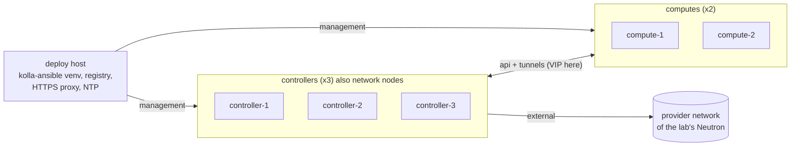

# Three controllers and two computes, nested inside an existing OpenStack cloud

A multinode Kolla-Ansible deployment whose hosts are themselves instances of another OpenStack cloud. It gives a
real HA control plane (Galera, RabbitMQ cluster, keepalived VIP) and real computes running KVM, without dedicated
hardware. It was built and rebuilt many times to reproduce failures on purpose, so it is close to Kolla-Ansible's
defaults on everything except what the hosting cloud forces.

## Context

- **Purpose.** A throw-away lab, rebuilt often, on which failures are injected and observed. It must behave like a
  small production control plane (three controllers, clustered services, a VIP) and run real instances.
- **Constraints of the hosting cloud,** measured before designing anything: project networks with an MTU of 1442;
  nested virtualisation available inside instances; allowed address pairs and per-port security available; VRRP and
  UDP 4789 passing between instances; **no trunk ports**; no Internet egress for ports without a floating IP; outbound
  TCP 80 blocked; a public address pool that runs out.
- **Budget.** Roughly 26 vCPU and 64 GB of RAM per lab. One lab at a time.
- **Skills.** One operator; the deployment had to stay readable as plain Kolla-Ansible.

## Topology



| Role | Count | Size | Runs |
|---|---|---|---|
| Controller | 3 | about 8 vCPU, 16 GB RAM | API services, Galera, RabbitMQ, HAProxy and keepalived, Neutron L3/DHCP/metadata and OVS agents (Kolla-Ansible's default groups put the network services on the controllers) |
| Compute | 2 | about 4 vCPU, 8 GB RAM | nova-compute, libvirt with `kvm` (nested), OVS agent |
| Deploy host | 1 | existing machine | kolla-ansible in a virtual environment, a local image registry, an HTTPS proxy, an NTP server |

## Network design

Without trunk ports, every host gets **one port per network**:

| Network | Hosts | Kolla-Ansible role | Port security |
|---|---|---|---|
| Management (the project's existing network) | all, and the deploy host | SSH and Ansible; egress through the deploy host | enabled, restricted to the deploy host |
| API | all | `network_interface` (internal API, service traffic) and, by default, `tunnel_interface` (VXLAN). Carries the internal VIP | enabled; the VIP allowed on the controller ports with allowed address pairs; IP protocol 112 (VRRP) allowed between members |
| External | controllers only | `neutron_external_interface`, plugged into the OVS provider bridge | **disabled**, because Neutron routers and floating IPs use addresses and MAC addresses the hosting cloud does not know |

- **MTU.** The lab networks inherit the hosting cloud's 1442 bytes. Neutron is told so with a configuration override,
  `/etc/kolla/config/neutron.conf`:
  ```ini
  [DEFAULT]
  global_physnet_mtu = 1442
  ```
  VXLAN tenant networks then get 1392 bytes. Without it Neutron assumes 1500 and large packets of the instances are
  silently dropped (see the VM runbook on tunnel MTU mismatch).
- **External interface on the controllers.** It must be up but carry no address, persistently, because OVS owns it.
  A netplan file matching the interface by MAC address with `dhcp4: false`, `dhcp6: false`, `accept-ra: false`,
  `link-local: []`, the lab MTU, and `optional: true` so that boot does not wait for it.
- **VIP and VRRP.** keepalived runs in unicast mode (`keepalived_traffic_mode: "unicast"`; the default in the
  `loadbalancer` role is `"multicast"`), so VRRP needs no multicast in the hosting cloud; Kolla-Ansible writes a
  `unicast_peer` list of the other load balancer hosts' API addresses. `keepalived_virtual_router_id` is also set to a
  value unique to the lab: the default `51` would collide with another lab or any other keepalived on the same
  network. The lab checks of 2026-10-27 recorded on the VIP timeout page and in the VM runbooks all ran in unicast
  mode. The first version of this page (2026-10-21) said the default multicast mode passed in this cloud; that was
  not checked again, and multicast mode has not been reproduced on the lab since.

## Storage design

- No Cinder, no Ceph: the lab enables Kolla-Ansible's default core services only, and adds optional ones when a
  reproduction needs them.
- **The instance store of each compute is on its own small volume** (10 GiB), formatted and mounted by host
  preparation on the data directory of Kolla-Ansible's `nova_compute` Docker volume
  (`/var/lib/docker/volumes/nova_compute/_data`) before Kolla-Ansible deploys. Kolla-Ansible's variables keep their
  defaults. Without this, a full instance store fills the root file system and takes Docker, the logs and journald
  down with the instances.

## Inventory and configuration layout

```text
/etc/kolla/
  globals.yml            the few values that differ from defaults (below), proxy and registry settings
  passwords.yml          generated by kolla-genpwd, never committed
  config/
    neutron.conf         global_physnet_mtu
inventory/multinode      Kolla-Ansible's multinode inventory: control, network, compute, monitoring, storage, deployment
```

Values that differ from Kolla-Ansible defaults, and nothing else:

| Setting | Default | Here | Why |
|---|---|---|---|
| `keepalived_traffic_mode` | `multicast` | `unicast` | VRRP without depending on multicast in the hosting cloud |
| `keepalived_virtual_router_id` | `51` | unique per lab | avoid VRRP collisions on a shared network |
| `global_physnet_mtu` (Neutron, override) | 1500 | 1442 | the hosting cloud's MTU |
| `prechecks_enable_host_os_checks` | `true` | `false` for the `deployment` group only | the deploy host runs Ubuntu 22.04, which the 2026.1 prechecks refuse; the lab hosts are still checked |
| `docker_registry`, `docker_registry_insecure` | quay.io | the local registry, plain HTTP | pinned images (below) |
| `docker_http_proxy`, `docker_https_proxy`, `container_http_proxy`, `container_https_proxy` and their `no_proxy` | unset | the deploy host's proxy | the only egress (below) |

Everything else: Kolla-Ansible defaults (`neutron_plugin_agent: openvswitch`, `nova_compute_virt_type: kvm`,
`kolla_container_engine: docker`).

## Key choices and their consequences

| Choice | Alternative(s) | Why this one here | Consequence in operation |
|---|---|---|---|
| Hosts are instances of an existing cloud | Bare metal; all-in-one | Cheap, fast to rebuild, real HA | Depends on the hosting cloud's features (nested virt, allowed address pairs, VRRP); if one is withdrawn the design must change |
| One port per network | Trunk ports with VLANs | Trunks not available | More ports per host; interfaces found by MAC address, not by name |
| VIP through allowed address pairs on a plain network | An overlay built between the hosts | Plain Neutron features, verified first | VIP failover depends on VRRP passing in the hosting cloud |
| Local registry with a tag that never moves | Pull from quay.io | quay.io republishes the Kolla tags every night, so two builds would not run the same images | One more service on the deploy host to keep up |
| HTTPS proxy on the deploy host for all egress | A floating IP per host; the router's SNAT | SNAT gave no egress here; port 80 blocked; the floating IP pool ran out | apt, Docker and containers must all get the proxy settings; `no_proxy` must list the API range, the VIP, the management ranges and the host names, or internal traffic goes through the proxy |
| NTP served by the deploy host | Disable the NTP prechecks | Galera and RabbitMQ need synchronised clocks; NTP does not go through an HTTPS proxy | One more service; the deploy host's clock becomes the lab's reference |
| Network services on the controllers | Dedicated network nodes | Kolla-Ansible's default groups; smaller lab | A controller failure also moves L3 and DHCP agents |
| `kvm` on the computes | `qemu` emulation | Nested virtualisation available; fast instances | If the hosting cloud stops offering nested virt, instances become slow enough to break timeouts |

## What went wrong during deployment

- **Unattended upgrades during `kolla-ansible deploy`.** The stock Ubuntu 24.04 image enables daily automatic
  upgrades. Its morning run upgraded 178 packages, `libc6` and `systemd` among them, on two hosts in the middle of a
  deploy: systemd restarted services, one container never started and MariaDB never formed its cluster. Fixed by
  stopping and disabling `apt-daily.timer` and `apt-daily-upgrade.timer` and waiting for any running upgrade to end
  before deploying, on every later build. Details in
  [the deployment error page](../deployment-errors/unattended-upgrades-during-deploy-breaks-the-mariadb-cluster.md).
- **No egress.** The project router had SNAT enabled but gave no Internet access to ports without a floating IP;
  outbound port 80 was blocked; the public address pool was exhausted. `bootstrap-servers` and `pull` failed until
  the HTTPS proxy and the HTTPS-only package sources were in place.
- **apt failing silently.** `apt-get update` only warns about a source it cannot fetch; running it with
  `--error-on=any` turned a confusing later failure into an immediate, explicit one.
- **Deploy host refused by the prechecks.** 2026.1 accepts only Ubuntu noble among Ubuntu releases, and the prechecks
  also run on the deploy host; turning off the host OS check for the `deployment` group only kept the check on the
  lab hosts.

## Version notes

- 2026.1 (Kolla-Ansible 22.x) requires Python 3.11 or later on the deploy host; the virtual environment uses
  Python 3.12 installed alongside the system Python, which also covers 2026.2.
- On Ubuntu 24.04, `bootstrap-servers` installs the Docker SDK from the `python3-docker` package (the system Python is
  externally managed), so pip and its proxy are not involved.

## Lessons learned

- Measure the hosting cloud before designing the lab: MTU, nested virtualisation, allowed address pairs, VRRP,
  trunks, egress. Every divergence from Kolla-Ansible defaults in this pattern comes from one of those facts.
- Keep the divergences in one table. The six rows of the table above are the only settings that differ from
  Kolla-Ansible's defaults here; everything else being default is what makes the lab's behaviour comparable with other deployments.
- Disable automatic upgrades on hosts you deploy to, or schedule them: they will otherwise run in the middle of a
  deploy one morning.
- Give the instance store its own file system on every compute, in a lab as in production.

## Validity and limits

Built repeatedly in October 2026 with OpenStack 2026.1, Kolla-Ansible 22.2.0, images `2026.1-ubuntu-noble`, Docker,
Open vSwitch, inside one particular hosting cloud. On each build the baseline checks, a VIP failover and a canary
instance per compute passed. Not tried: OVN, Podman, Cinder or Ceph, dedicated network nodes,
other host distributions, other hosting clouds. This is a lab pattern: it is not a recommendation for production,
where the external network, storage and failure domains would be designed very differently.

## Related

- VM runbook: tunnel MTU mismatch, in `openstack-vm-runbooks` (`networking/`).
- Source: lab builds by @soufian-zaouam (OpenStack 2026.1, Kolla-Ansible 22.2.0).

---

*Provenance: written by agent:ozarland-author, from lab builds by @soufian-zaouam on 2026.1.
Reviewed in its pull request (see the page history). Checked by a human operator: not yet.*

**Worked for you, or not?** [Tell us in one line](https://github.com/OzarLand/kolla-ansible-deployment-patterns/issues/new?template=documentation-proposal.yml&page=topologies/three-controllers-two-computes-nested-in-an-openstack-cloud.md&title=Feedback%3A+topologies/three-controllers-two-computes-nested-in-an-openstack-cloud.md):
your release, your topology, and what happened.
